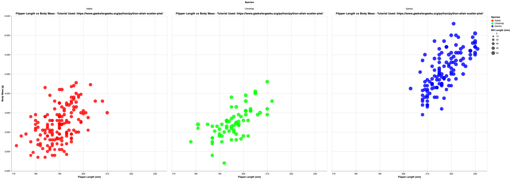
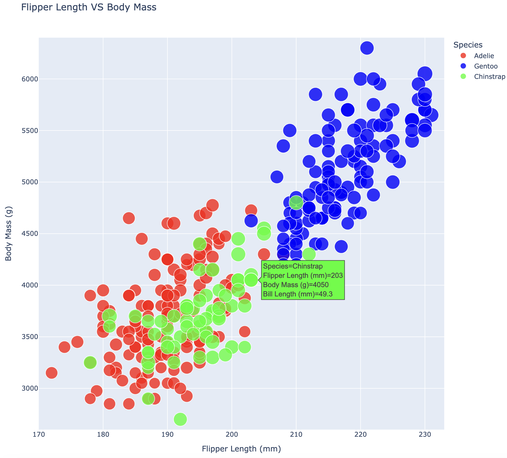

# Original

# Excel

Technical Achievements: 

For the excel solution, I created three tables, each for a different species. I then used a bubble scatter plot to create the graph, and created three series, one for each species. For each series, I had to manually specify the column for the X and Y axis for that species. From there, I adjusted the size of the bubbles, and the transparency. The bubbles for each series do scale by bill length. The Excel file is attached in the Excel folder. I also adjusted the scaling to match the scaling from the origin image. I think the hardest part was splitting the species, as I basically had to filter by species, and copy the whole dataset into a different workbook. Scaling the axis was very easy, and everything was GUI based so Excel definetly gets points for that. I could see this being very useful for complex visualizations that are easier to create in a GUI. I did have to manipulate some data by removing the N/A points, and created the three different graphs for the different species. 

Design Achievements:

Unfortunately, one of Excels bigger downsides is the lack of customization. There are definetly things I customized like the title, and the series, but other than that there are some other basic presets that can be chosen, and fonts changed, however I expect the coding tools to have a lot more customization. 

# Tableau

Technical Achievements: 

Creating this graph in Tableau was awesome. I started by importing the data, and that was as easy as dragging in the column and row. To make the sizes of the circles, it was as easy as just dragging bill length into the marks card. I was able to make each point a circle by just selecting the shape from a drop down, and changing the axis were two clicks away. Opacity was also extremely simple, it was just a percent that could be changed. Overall, nothing about Tableau was hard, and the only slight hiccup that I encountered was not being able to adjust the bill length scaling (see how it goes from 32, 40, 50, 59). I really like Tableau, and this might be my preferred method of creating graphs, and I was shocked at how much easier it was when compared to Excel. I see this being useful for simpler visuals that are easy to create in a GUI. I didn't have to use any hacks or data manipulation.

Design Achievements:

Like Excel, there wasn't that much that could be done to alter the design in Tableau, which is definetly one of its downsides. However, I tried to keep the labels consistent and really like the colors it chose so honestly have no complaints there. 

# d3

Technical Achievements:

I didn't like d3 as much as the other solutions, although I think that makes sense as not having a GUI and having to manually code the task out is typically harder, although I do think that it allows for a lot more customization. I heavily used this website as a reference when I built the d3 file, linked here: https://d3-graph-gallery.com/graph/scatter_basic.html. This was a really good example layout, as I followed the basic structure of this example. The major technical achievement that I chose to focus on in this was printing the Flipper Min and Max in the dataset, as I thought it would be cool to see the extremes of flipper size. One thing that I did struggle with was getting the sizes of the circles corresponding to the bill length. The bill length gets passed in from the CSV and is converted to a number along with the other variables with this code: d.bill = +d.bill_length_mm;, then I created a variable r (for radius), and used d3.scaleSqrt().domain(d3.extent(data, function(d){ return d.bill; })).range([2.5, 9]); The sqrt makes the scaling look more normal, and the domain sets the input range reading from the bill lengths, the range is the sizes of the circles in pixels. 

Design Achievements: 

Since this was my first library example, and these graphs are highly customizable as it is code focused, I tried to create a coherent color scheme using RGB values where (Red: FF0000, Green: 00FF00, Blue 0000FF) that I plan on using accross the other examples. I also tried to keep the labels from Excel and Tableau, and decided to link the tutorial below. I also tried to keep the overall design compact and relatively clean, but simple. 

# Altair

Technical Achievements:

I really like Altair, and I was honestly expecting it to be a real pain and to take many lines to get the graph close enough to the original image but it really was very easy. I used the GeeksForGeeks tutorial for reference: https://www.geeksforgeeks.org/python/python-altair-scatter-plot/. Basically, all I had to do really was import the libraries, load the CSV in pandas, and then I just created the chart, and added a bunch of configuration stuff and it just worked. I think again the hardest part was the bill length getting the size of the circles working, as it does work but the difference is very small, and playing around with it kept breaking my code. I really like Altair and could see it being used for potentially integrating visuals into already existing python code, where more configuration potentially is needed. For technical achievements, I decided to create more graphs than just the original graph, as I wanted to show the species seperated on their own. That was actually relatively simple to do, and used chart.facet. 

Design Achievements:

I tried to stick with the same design across all of the code examples. This means that I used the custom RGB colors, using range=["#FF0000", "#00FF00", "#0000FF"]. I also tried to keep the axis labels, and spacing as close as possible as I could to d3. I also kept the corresponding colors on the other species graphs by themseleves, so it is easy to compare the 3 individual graphs to the main big graph. 

# Plotly.js

Technical Achievements:

I've used plotly.js in the past with Flask and Dash before, so I thought I would use this here, as I like Plotly.js a lot and it seems to be relatively simple, while still having a lot of customization options. I originally was thinking about using Matplotlib, as I have also used that a lot before, however Matplotlib is honestly old and most likely would take a long time to configure, and I think Plotly.js looks nicer. The overall architecture of my python script is actually very similar to Altair. The CSV is read using basically the same pandas dataframe setup, and then like Altair, all you have to do is really make the graph object and specify the configuration options to make it look similar to the original image. The one really hard thing about this though, was originally I was trying to use plotly.graph_objects, however some weird configuration of using a venv and python not being satisfied with that dependencies requirements forced me to have to google an alternative. Luckily, plotly.io exists, and actually renders it in the browser. This also has the added benefit of being able to add hover events which is a cool technical achievement. I still definetly recommended plotly, and altair, and honestly the only library I really didn't like was d3. I could see Plotly.js being used for similar tasks as altair, and seems to play nicely with websites as well. 

Design Achievements: 

I tried to stick to a similar design, using pure RGB values for each species that I used in the other code examples, and I wanted to experiment with how the programs rendered different colors. I also tried to keep as much consistent as I possible could accross the different code libraries. This includes the spacing for the X and Y axis, and the labels. I also wanted to make sure that when you hovered over a point, the box was the same color as that point, as I feel that is a lot easier to read. 