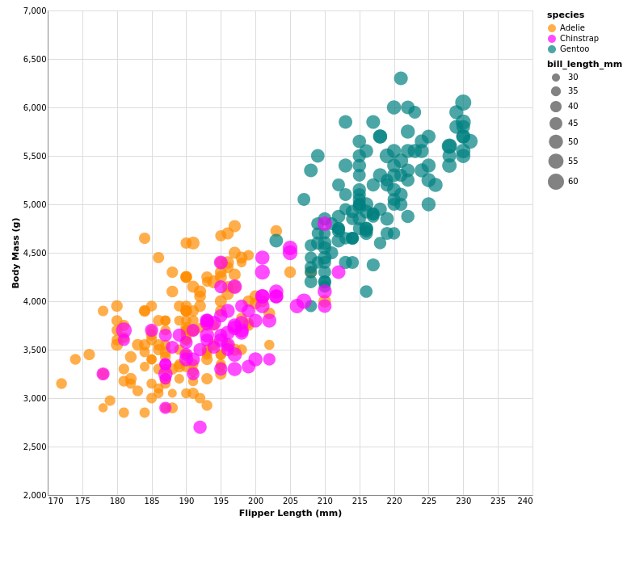
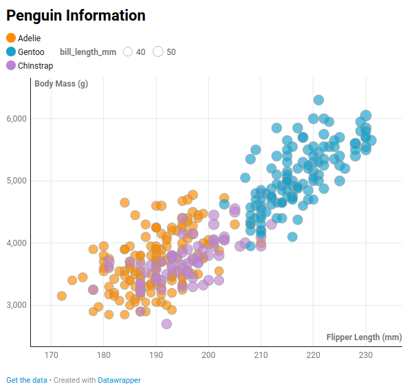
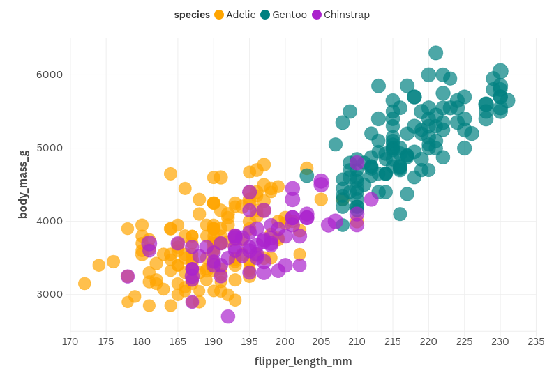

# 02-DataVis-5ways

Assignment 2 - Data Visualization, 5 Ways  
===

# d3 + JavaScript

JavaScript is a language primarily for web scripting.
d3 is a popular JavaScript library for creating data visualizations for websites. d3 makes use of SVGs to provide many different options for visuals and interactivity.

I used d3's built in CSV parser to read the data, then built the x and y axis and inserted circles into the plot based on the data. I then provided mouse functionality for hovering over data points.

There are many samples of d3 charts online so there were plenty of examples to help understand th ecode. d3 allows for tons of customization at the cost of ease of use. Some of the SVG features were hard to work with, suhc as the axis titles, since you have to manually translate the text to go to the proper location.

To run this, I used VSCode's built in web server functionality since we need to load a local CSV file, which is blocked by CORS.

# Vega-Lite + JavaScript

Vega-Lite is a JavaScript library that provides JSON syntax to create visualizations. Unlike d3 where you have to specify the creation of an SVG yourself, Vega-Lite will automatically do it.

I used Vega's schema for the JSON, specified the height and width of the graph, and then specified the encoding. The encoding allows for many channels, including size, color, x, y, and shape.

I found the syntax to be easier than d3 but it was harder to figure out how to manipulate certain things. Since d3 relies solely on SVG's, it's easy to figure out which attributes you can change. I found Vega-Lite's documentation more difficult to parse. If I needed a simple graph without much customization I would choose Vega-Lite over d3, but Vega-Lite does not provide options for interactivity as far as I can tell.

To run this, I used VSCode's built in web server functionality since we need to load a local CSV file, which is blocked by CORS.

# Altair + Python

Python is a programming language that emphasizes code readability. It is commonly used in the data science industry.
Altair is a Python package that allows users to create visuals, which are generated into an HTML file. Altair is essentially a generator for Vega-Lite visualizations.

Overall I found the syntax for Altair to be more intuitive than Vega-Lite, but again there is the issue of documentation. There aren't great examples of Altair code in the docs so I had to do a lot of guessing to figure out how to make certain things work. Even then, I couldn't figure out how to make the size scaling work the same way as it does in Veha-Lite. Again, I think this fills the same niche as Vega-Lite, if you want an easy way to create a chart without interactivity.

# Datawrapper

Datawrapper is an online tool for creating data visualizations. You can upload your data, and Datawrapper will automatically parse the data and provide options for different chart types. After picking a specifc chart, you can customize the chart, provide annotations, and then publish the chart, making it accessible with a link.

I was pleasantly surprised with the customization that Datawrapper provides. There are many options for the axes, color, size, and shape of the data points. You can customize the position, the number format, there are options for basic interactivity, and you can easily adjust the labels and title for the graph. There are certain things I wish Datawrapper had, like moving the position of the axes titles while keeping the axes the same place, but overall I was impressed with Datawrapper's capabilities.

I think Datawrapper is great for creating visuals that you want to share with people easily since you can just share a link to the chart. You can also insert it into a website with an iframe.

<https://datawrapper.dwcdn.net/IYxC4/1/>

# Flourish

Flourish is an online tool for creating data visualizations. The main focus for this tool is compatibility with Canva, which is an online image and video editing platform.

I found Flourish to be a worse option than Datawrapper for one main reason: the UI in Datawrapper is much nicer and laid out more intuitively. In Flourish all the options are crammed into a side panel, making it difficult to find exactly what you need. There are probably options that could have made the chart look nicer, but I just couldn't find them. Additionally, there are some options that you need Canva Pro to use, like downloading the chart as an HTML file.

Like Datawrapper, you can publish the chart and make it accessible with a link, or embed into a website. However, since Datawrapper is a better tool to work with in my opinion, I would rather stick to Datawrapper than work with Flourish unless I was specifically making a visual for Canva.

## Technical Achievements

- **Interactivity**: On the d3 visual, hovering over one of the points provides additional info about the selected point

### Design Achievements

- **Additional Visual Features**: I provided a legend in all of the visuals besides for d3
