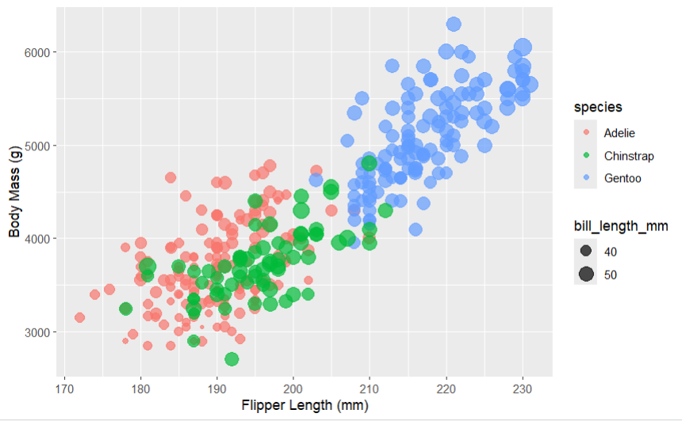
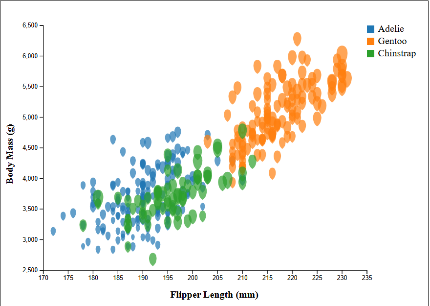
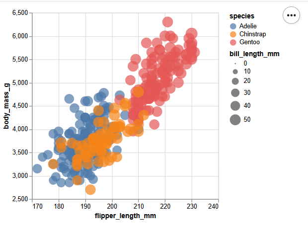
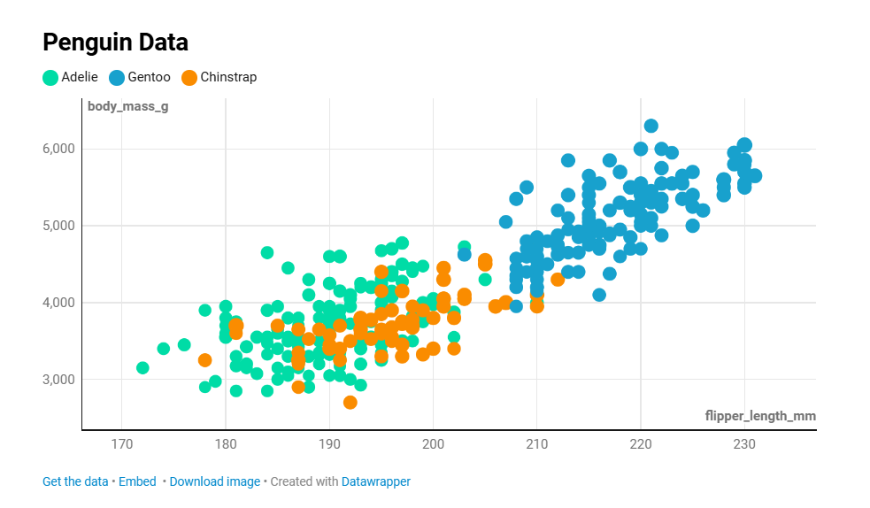
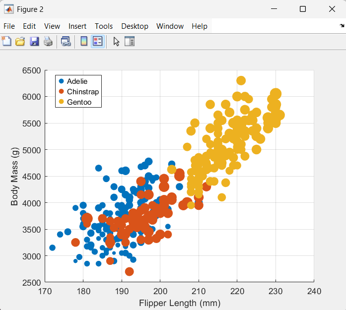

# 02-DataVis-5Ways
Assignment 2 – Data Visualization, 5 Ways  
Apologies to whoever is grading this assignment for our class
===

This project explores five different tools and libraries for data visualization by recreating the same scatterplot using the `penglings.csv` dataset. Each visualization maps:

- **X-axis:** Flipper Length  
- **Y-axis:** Body Mass  
- **Color:** Species  
- **Point Size:** Bill Length (Unfortunately the sizing difference in the DataWrapper implementation can not be seen despite my tinkering)  
- **Opacity:** ~0.8 (Not possible in DataWrapper or MatLab from what I could see) 

All source files can be found in the `penglingGraphingCode/` directory, and screenshots are stored in `img/`.

---

# R + ggplot2

R is a language focused on statistical computing, and `ggplot2` is a powerful grammar-of-graphics library that makes mapping data to visual attributes very expressive. ggplot also lowered the lines of code I needed to usse to replicate the graph significantly, as I attempted that prior to the ggplot version. 

For this visualization, I used `geom_point()` with aesthetic mappings for color (species), size (bill length), and alpha (opacity). Setting custom axis limits was kind of straightforward, which made it easy to match the reference chart where the scales do not start at zero.

This was the best tool (in my opinion) to closely replicate the original visualization with minimal effort. Most of the challenge came from learning the syntax rather than fighting the tool itself. ggplot2 feels especially well-suited for exploratory data analysis and publication-quality charts. It gets 5 stars from me.

---

# d3.js

d3.js is a low-level JavaScript visualization library that provides complete control over every visual element, but requires significantly more code than higher-level tools. Like a lot more code.

I loaded the dataset using `d3.csv()` and manually created scales for position, color, and size. Axes were constructed using `d3.axisBottom()` and `d3.axisLeft()`, and circles were appended individually with mapped attributes. Honestly the logic wasn't hard to think through; especially after Project 1. 

The hardest part of using d3 was making and using the legend. First of all, this was the first program I wrote for this assignment and thought the "legend" was going to be called a "key" in the API (as that is what I knew it as). It wasn't, which slowed me down more than I'd like to admit. Afterwards, the legend element was just wierd to position. I got the hang of it in the end though.

---

# Altair (Python)

Altair is a declarative visualization library for Python built on top of Vega-Lite. Instead of manually drawing elements, you describe what you want to visualize and let the library handle the rendering (which was pretty cool).

Using Altair, I mapped flipper length and body mass to the axes, species to color, and bill length to size using a single chart definition. Adjusting opacity and scales was simple, though some fine-grained layout control is more limited compared to d3, and honestly the graph didn't come out perfectly. The size scale was super funky in particular, which you can likely pick out from the image.

Altair is very effective for quickly generating clean, readable visualizations with minimal code. It feels like a strong middle ground between ease of use and expressive power.

---

# Datawrapper

Datawrapper is a web-based visualization tool that emphasizes accessibility, speed, and polish over deep customization. It was by far the easiest to use.

I uploaded the `penglings.csv` dataset directly through the interface and configured the scatterplot using the built-in UI controls. Color and size encodings were easy to assign, though precise control over scale limits and styling was more constrained compared to code-based tools, and I honestly can not see the size difference in the dots. The hover feature that isolates data of the same color as the selected point was super cool though.

Datawrapper would be especially useful in journalism or public-facing dashboards where fast turnaround and clean presentation matter more than full control.

---

# Matlab

Matlab is a numerical computing environment commonly used in engineering and scientific fields. Its plotting tools are powerful but less specialized for modern data visualization.

I used Matlab’s `scatter()` function, manually mapping color, size, and opacity. Customizing legends and axis scales required more trial-and-error than in ggplot2 or Altair, and aesthetic defaults are less visually polished in my eyes.

Despite this, Matlab performs well when visualizations are part of a larger numerical or simulation-based workflow, especially when the data is already being processed in Matlab.

---

## Technical Achievements

- Added a hover feature to only show data with the same species as the hovered over point, like in the DataWrapper version (d3-version exclusive)
- Successfully recreated the same visualization across five different tools
- Loaded and processed CSV data in multiple environments (R, Python, JavaScript, Matlab)
- Implemented custom scale limits that do not start at zero
- Mapped multiple visual encodings simultaneously (position, color, size, opacity)
- Worked with asynchronous data loading in d3

## Design Achievements

- Added a penguin bill like shape to the plotted points to help with the bill-length sizing visual and theming (d3-veresion exclusive)
- Maintained consistent visual mappings across all tools
- Used semi-transparent points to improve readability in dense regions
- Chose color schemes that clearly distinguish species
- Adjusted point sizing to reflect bill length without overwhelming the chart
- Preserved readability through clear axis labels and tick spacing
