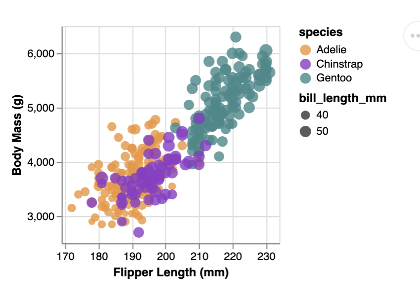
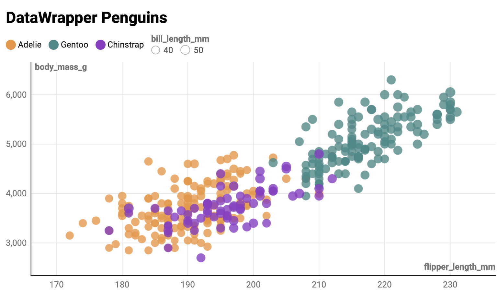

Assignment 2 - Data Visualization, 5 Ways  
Gabriel Olafsson
Feb 8th 2026 (using 2 late days)

###### d3

This is the first one that I did and for talking to some other folks in the class about it, it seemed like I got the hardest one out of the way first. I really did like this one because, yes, it was really annoying, but with that it gave you a ton of control over what you are actually doing. I think this will be a very good library to use for making complicated visualizations that you want to have a ton of control over and I am excited to be using this in the future. Absolutly A teir.

###### Vega-lite

B teir.

Limitations:
- There seemed to be a technical limitiation that made it not possible for me to set a common grey box behind all of the colors and all of the size compareisons, which makes the legend a little bit harder to understand at a glance
- I could not even get ai to help me in getting the ordering of the legend correct, so I think that might be another limitation of vega lite

##### DataWrapper

This one was by far the easiest to create. And suprisingly not as limiting as I would have thought based off a gui. I would rate this C teir due to the lack of customizablitly, but for someone that wants something quick (or doesnt want to bother with code) just to show some chart for a meeting it would absolutly be A teir because of how easy it is to use. Very accessible, but inherently that comes at the trade off of customizablity.

##### r + ggplot2

I really do not like r, but even so, this ggplot2 was supper easy and consise, though limmiting when it came to ordering the legends. I also just generally dont really like how it is exported to a png instead of something that you can actually interact with (also space complexity and transfer times when it comes to high quality images, it is much nicer in my opinion to use something that uses svg paths that basically has no limititiations on defintion). B teir (if i wasnt bias it would be an A)

##### altair

This is the only one that I was not able to figure out the background for. Even though I love python, I was not as big a fan of it being used in this way. I think the json files make more sence, and I even liked r more than python on this specific use case. It feels limited and, to my suprise, made less sence to me than the ggplot2 which I had gone into that one with very negitive opinions. I had the adverse starting bias, but walked out really not caring for this one. D teir

##### Acheivments

Technical:
- Added full legends (size and color) to all visualizations
- Parsed the csv on all visualizations, filtering and "NA" entries
- Adapted a cisualization to many differnt  ()
- Set all the body mass bounds to be 2500 - 6500
- Set all the flipper lengths to be bound by 169-234 (not on the axis lines)
- Applied radius scaling to all implementations for bill lengths
- 80% opacity for all circles fills (bill length) fill and an 100% for the outline, also assigning each to their respective colors
- Interactive pages for the datawrapper, d3, and vega lite graphs as they can be hosted and the others were exported to a png

Technical Challenges / Limitiations:
- bounding box for the size in the legend was inconstent and not acheived on altair, datawrapper, or vega lite
- altair and ggplot2 are not interactive as they were exported as pngs
- legend ordering was inconsistent, not being acheived on vega lite or datawrapper (they have default ordering that I could not figure out how to bipass)
- Datawrapper legend is on the top instead of the right (gui limitation)

Design:
- Visual consistency across platforms: Even though they were not required, I added (tried to as altair is the only one that I was not able to figure out) legends and background grid to every visuallization. I think this really helped me in understanding the limitations of each and ultimatly was the reason why I came to the conclutions I did on the teir system.
- Consistent color pallet and opacity on

Design Challenges:
- No grey background color on vega lite, datawrapper, and altair
- No grid lines on altair

Personal:
- Made a tier list for all of the integrations just for myself to know which ones I really like and which ones I did not and explained the reasoning behind each
- Came to the conclution that d3 was my favorite, big learning curve and time comitment, but the things that you can do with d3 excite me