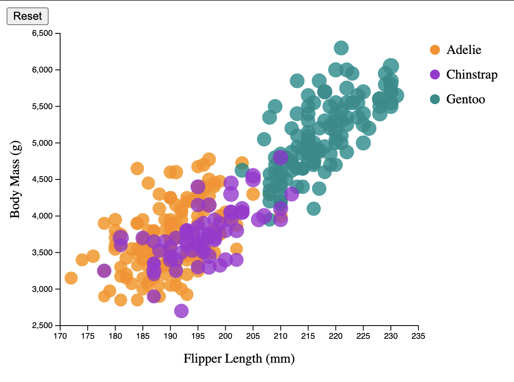
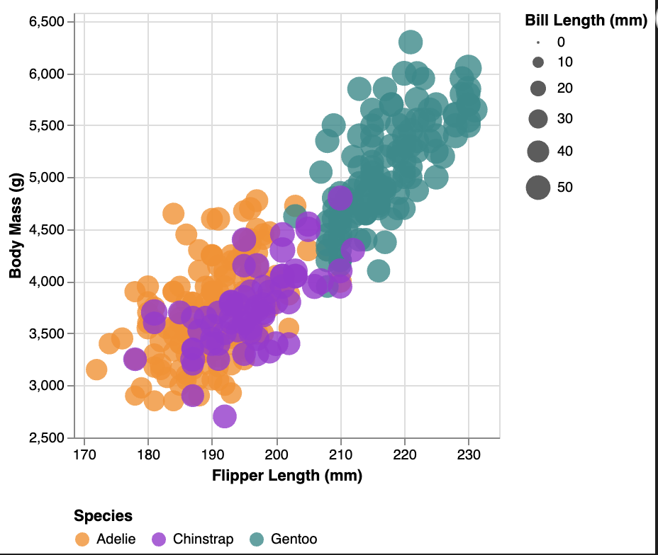
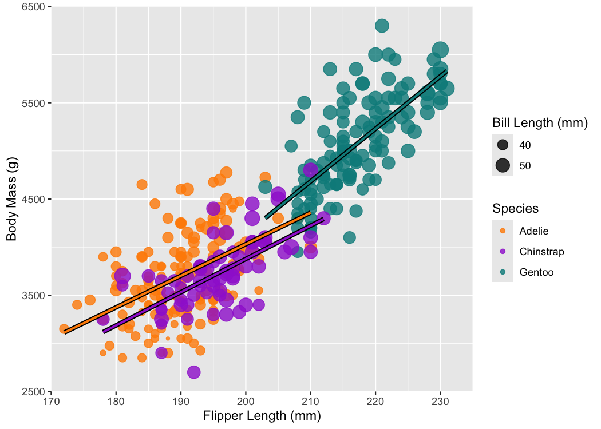
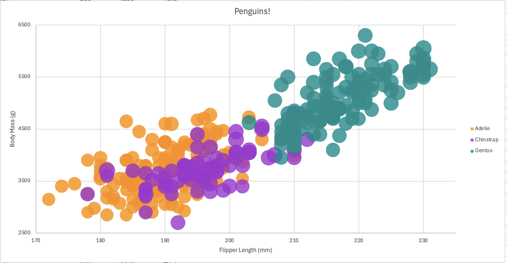
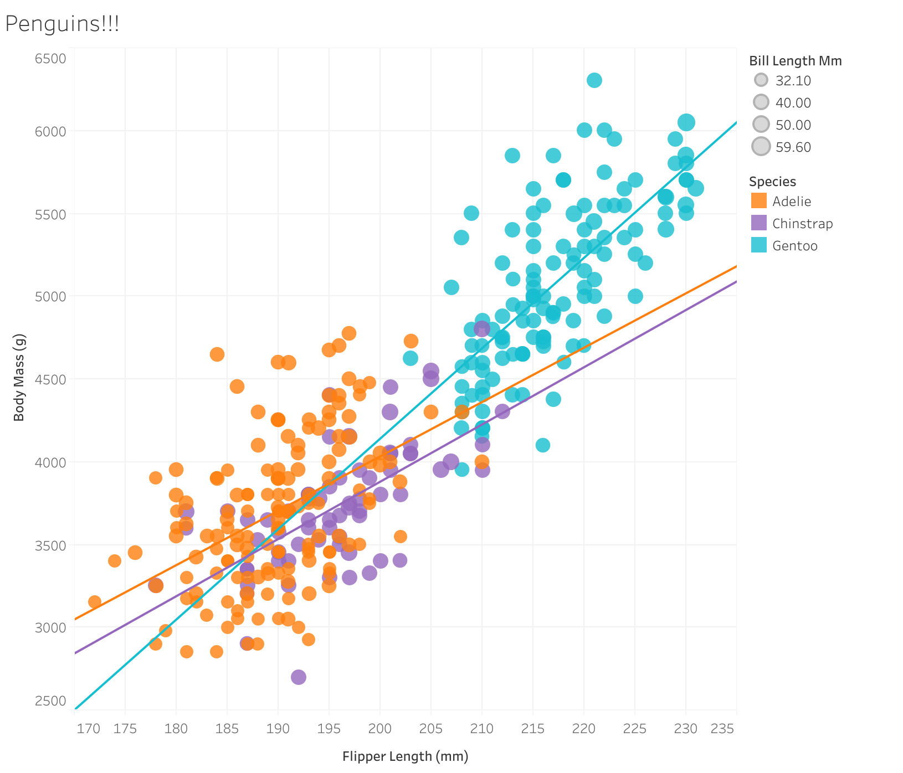

D3 Example: 

Sources Used:
https://d3-graph-gallery.com/graph/bubble_basic.html
https://d3js.org/d3-selection/events
Changes Made: 
I changed the starter code to use the penguin data and matched the species colors, bubble sizes, axis labels, ranges, and opacity to the example. I added a hover feature to the legend that fades out the other species so it is easier to focus on one at a time. I also added a basic click-to-zoom feature that magnifies the area clicked, with a reset button to return to the original view. 
Thoughts:
D3 felt pretty unintuitive to me, and it ended up having the most lines of code out of the three libraries I used. Things that were pretty straightforward in the other tools and libraries I used required more code here, especially the interactions. I ended up being able to get it to do what I wanted it to, but it took more lines of code and more work than I expected.
Altair Example:

Sources Used:
https://altair-viz.github.io/gallery/bubble_plot.html
https://altair-viz.github.io/gallery/interactive_legend.html
Changes Made:
I replaced the car data with the penguins data and matched the colors, axis labels, ranges, opacity, and the bubble sizes. I added a hover feature to the legend that fades out the other species. I also enabled scrolling to zoom and dragging to move around the chart, with the ability to double-click to reset the view.
Thoughts:
Altair was pretty self-explanatory. I used a notebook as my coding environment, and I used pandas, which I have worked with in the past as part of my junior year internship. Because of both of these things, I was pretty comfortable with using Altair. Overall, it was one of my favorites because it felt very straightforward, and I was able to easily get the graph to look how I wanted it to.
ggplot2 Example:

Sources Used:
https://ggplot2.tidyverse.org/reference/geom_point.html#examples
https://davidgohel.github.io/ggiraph
https://davidgohel.github.io/ggiraph/reference/geom_smooth_interactive.html
Changes Made:
I changed the starter code to use the penguin data and matched the species colors, bubble sizes, axes, and opacity to the example. I used ggiraph to add highlighting that fades out the other species when you hover over one. I also added trend lines for each species, and outlined them in black by just putting one on top of the other, and I made sure to layer them on top of the bubbles. The trend lines also fade out when a different species is highlighted, like how the bubbles behave.
Thoughts:
R was unintuitive in the fact that I had to install other packages to make the graph interactive and actually see what the final version looked like. I needed ggiraph for the interactions and htmlwidgets to export the graph as an HTML file that I could open in a browser. I also had to install Pandoc to save it as a self-contained HTML file. It worked in the end, but those extra steps made it feel less straightforward than Altair or Tableau.
Microsoft Excel Example:

Changes Made:
I imported the penguin data and arranged the columns to create a bubble chart with flipper length, body mass, etc. I matched the colors, labels, ranges, and opacity to the other charts as well, and properly sized the bubbles.
Thoughts:
I felt like Excel was one of my least favorite methods, and it was pretty messy for me to use. It seemed like everything I wanted to do in order to customize my chart was hidden behind piles of menus and dropdowns, and I had to arrange the data and set up each species separately instead of automatically like in Tableau. I really didn't enjoy working with Excel, even though I am fairly experienced with it.
Tableau Example:

Changes made:
I used the penguin data and matched the colors, axis labels, ranges, bubble sizes, and opacity to the other charts. Legend highlighting ended up being automatically included. I also added trend lines super easily by just dragging them into the chart. 
Thoughts: 
Tableau was definitely the easiest to use by far out of all of the programs in terms of strictly using it for data visualization. Everything I wanted it to do, it supported either automatically, or it was as simple as dragging and dropping. In the future, I would definitely choose Tableau if I were working with data like this. Overall, I enjoyed Tableau and Altair the most because they were user-friendly and felt familiar. 
