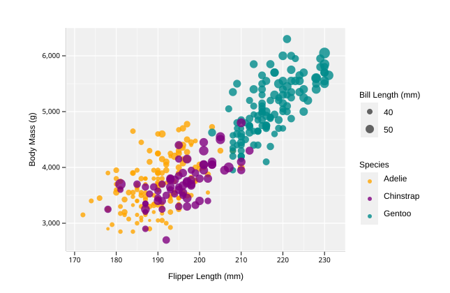
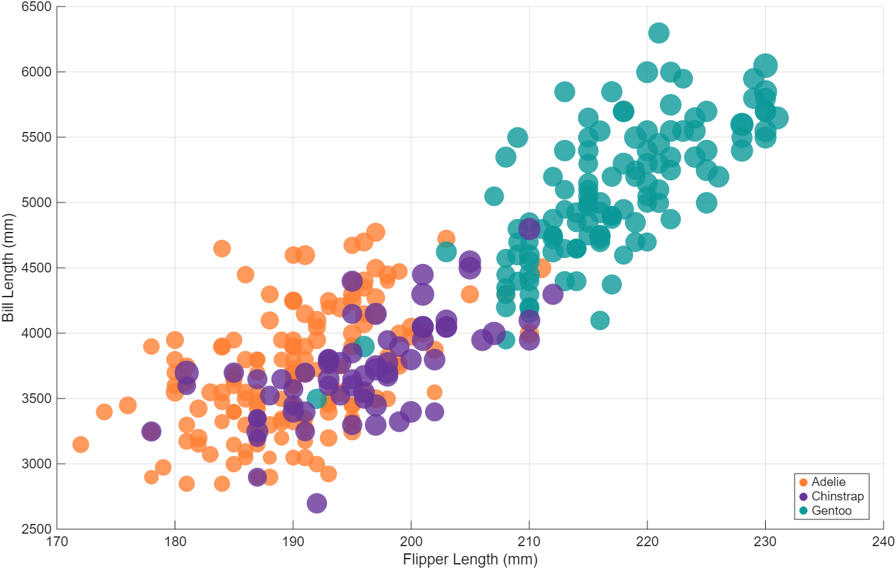
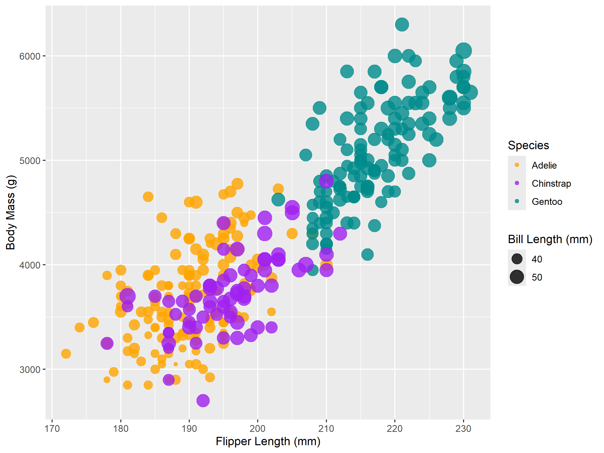
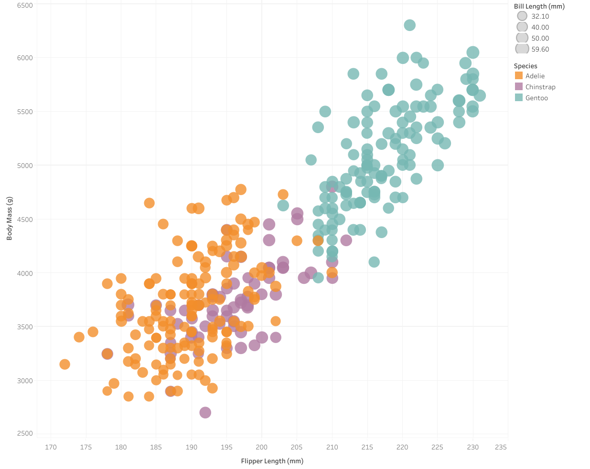

d3
===
d3 was a pretty straightforward method to make this graph. I was able to match it to the original very closely. I found a template for bubble plots [here](https://d3-graph-gallery.com/graph/bubble_template.html), which I copied and modified for my data. This template featured some interactivity—hovering over each of the colors/species in the legend reduces the opacity of the other two in the plot, making each respecive species much more visible. I likely would not have added this if it wasn't already in the template, but it was a very nice touch that didn't seem all that difficult to implement. I would say d3 fairly easy to use, but I also already have experience with it. One complaint I have about d3, and it could have just been the way that I did it, is that I had to manually place labels and the legend. It would have been nice if this could have been handled automatically. I like being assured that everything is aligned "correctly". d3 is definitely a very useful library for people with lots of web development experience who want control of every little detail on the graph. I would like to see options that take less code.

MATLAB
===
I'm pretty familiar with MATLAB and I've used it to visualize data in the past, so I figured I'd give it a go with this. I relied mainly on Google searches and some guidance from the built-in MATLAB Copilot to construct this graph. MATLAB documentation isn't always all that great, and functions aren't the most straightforward, but I thought it was really cool that there is essentially a single function that generates a graph with all the data. MATLAB has some built-in ordinal color set, but I really wanted to use my own, hence the for loop in the code. I also needed to have a way to check if the point is "valid" and only display those, as some of them have "NA" as their value, which was quickly revealed to me. MATLAB also doesn't allow you to do much to customize the legend, at least not in a straightforward way, so I managed to get the species in the legend but there was no way I could easily find to do this for the size dimension, bill length. The tooltip is not much help either. It shows x, y, size, and color, not the raw data, and I'm not sure if I can change it because MATLAB is designed for visualizing equations, not necessarily this kind of data the way we want to. The size value is the size of the point, which is different than the original dataset because I had to scale it so that the data was easier to read and better matched the original. I'm glad I did it, but I would not recommend this method for typical data visualization. It wasn't overly difficult, but there's not much customization we can do. Definitely a better tool for mathemetitians than anyone else.

R + ggplot
===
Wow, that did not take much code at all. I can tell ggplot is designed for this application, and I know R in general is focued on statistical computing. This was my first time ever using R, and even still, the hardest part about all of this was installing it. I found the basics for bubble plots in ggplot [here](https://ggplot2.tidyverse.org/). Once I did this, could tell instantly that the reference graph on the assignment README was made with ggplot. I couldn't figure out how to match the color palette though. I assumed it was one of the built-in ones, but I ended up just figuring out how to make a custom palette. Still super easy overall. I did not need to use an R Markdown file like what is mentioned in the example README, so this may be worth exploring in the future. This is a great option for people with R experience. I however, have none, so I would prefer something in another language such as Python, which I am much more familiar with, even if it requires a bit more code.

Tableau
===
This genuinely took no time at all. Tableau is designed for this sort of stuff. The hardest part genuinely was making an account. Afterwards it was incredibly straightforward. I like what you're able to customize, and the fact that it's no-code certainly helps make good data vis more accessible. I was able to add a tooltip as well. This is definitely a great option for those looking for a no-code option. The GUI made the software quite easy to figure out. I didn't require any external resources to help me, like I did for the other methods. I'm sure the lack of programming does limit what you're able to do in terms of little details, but it was so incredibly painless to use, so it's definitely a good "lazy" option that still produces really solid results.

You can view the project [here](https://public.tableau.com/views/4-Tableau_17945165089990/Sheet1?:language=en-US&:sid=&:redirect=auth&:display_count=n&:origin=viz_share_link).

Altair
===
Altair was also very nice and easy to use. It took a bit more code than ggplot, but I think it makes a bit more sense. This is also likely because I'm very familiar with Python. I was able to add a tooltip quite easily which was really nice. I started with [this example code](https://altair-viz.github.io/gallery/bubble_plot.html) and went from there. The hardest part of this was figuring out what to Google to get what I wanted, but now that I'm familiar with the concept of it all and where to look, I could see myself using this again. I think this is a great option for programmers of any level since the code is very easy.

Achievements
===
## Technical Achievements
This assignment introduced me to a plethora of data visualization resources. It was also my first time using R, so I can kind of say I know a new programming language now. While exploring these different options, I was able to allow users to interact with data in a few different ways, mainly through implementing tooltips, which allow the user to hover over points to see the specific values for each axis. This is very helpful for the size channel, as it's fairly difficult to compare bill length data by looking at the size of the bubble alone. For all of these as well, I made sure to use more human-readable labels for each of the dimensions, not the headers in the CSV, and I was able to do that without modifying the CSV at all, which was nice. In the d3 plot, hovering over the species on the legend brought the opacity of points of other species down to 0.2, making it easier to view data for that specific species. Understanding the capabilities of each of these ways to visualize data will prove handy when it comes to future projects in this course and likely beyond.

## Design Achievements
In all of the different methods I explored, I tried my best to replicate the original graph as close as reasonably possible. For all of the plots, this involved a custom nominal color palette, as the original provided good contrast, as well as some tinkering with the size of each of the dots. I tried my best to make sure the size contrast was the same if not a bit greater than the original. For some of the plots, I also had to specify the range of the X and Y axes and the tick interval. I found that the size dimension, although the only dimension still available on a bubble plot, is not really the most effective way to communicate bill length, as it is difficult to compare since they do not share a reference point, and many of the points overlap. As a design choice, it suggests to me that out of the other pieces of quantitative (ratio) data displayed, bill length is the least relevant. Having an understanding of how different design channels affect the ability to percieve data will prove useful for ensuring the effectiveness of future data visualizations.