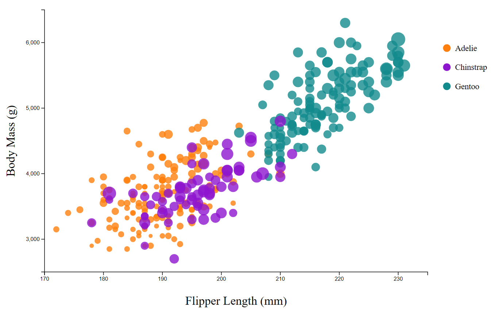
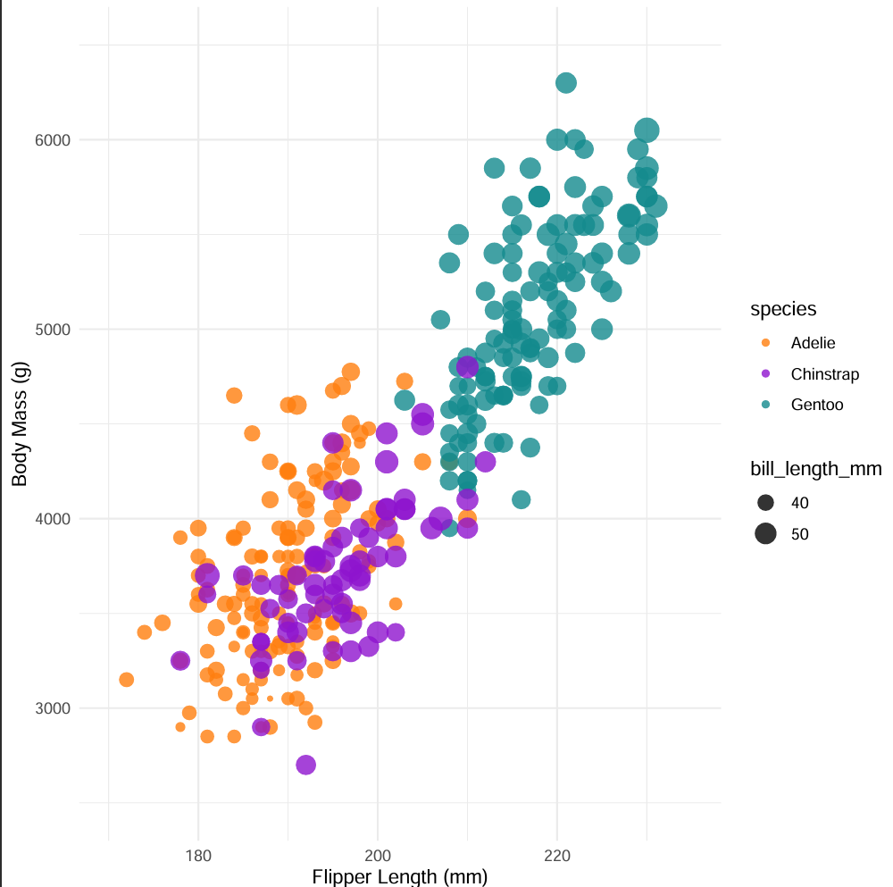
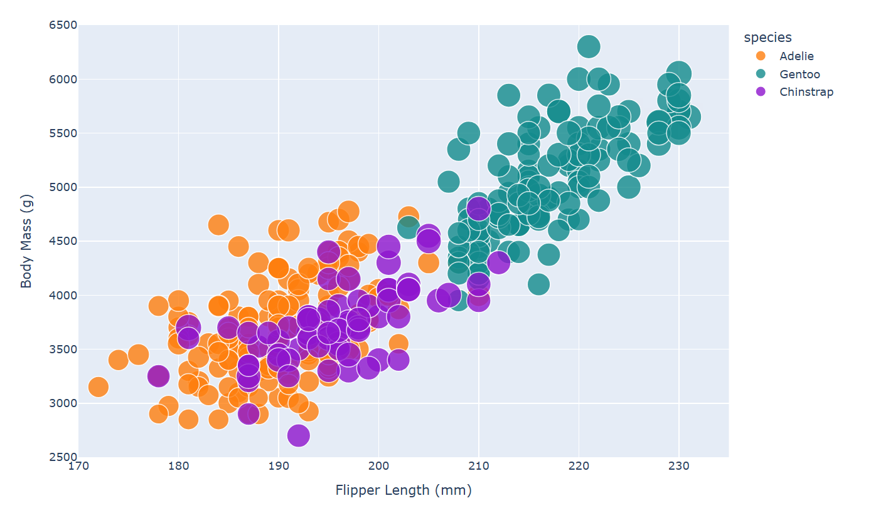
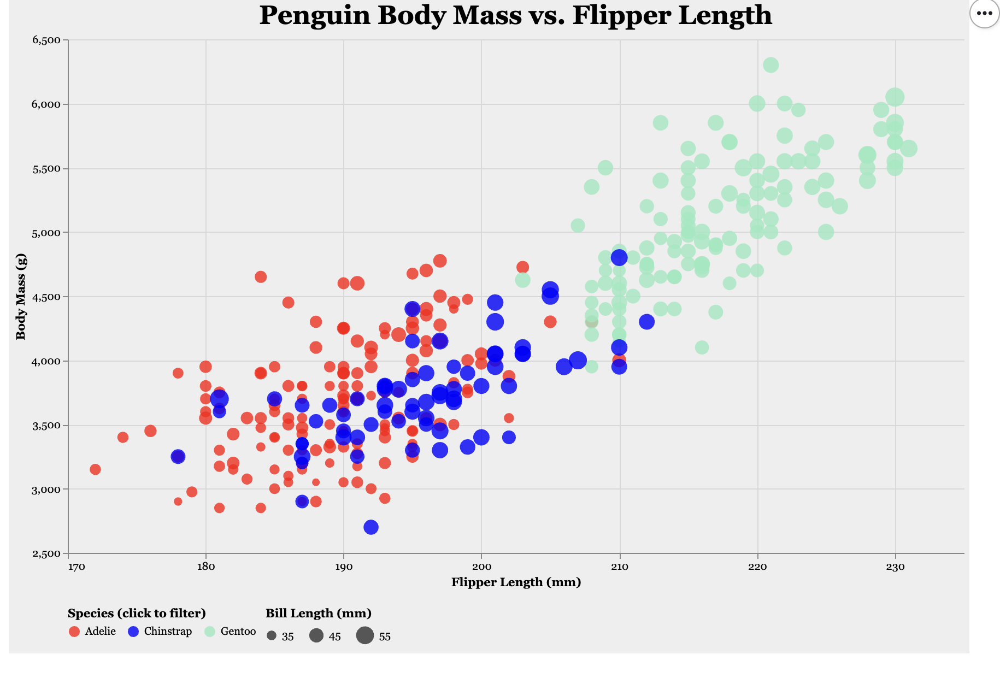

# README

# d3

D3 was probably the most complicated of the five, taking up the most amount of written code to implement. I used d3.csv() to load the data and then used the penguin measurements to determine where the circles should go. D3 seems useful for making more customized visualizations, although it requires more work than the other libraries.

# altair + python

Altair was much easier to use than D3. Most of the visualization was created using .encode(), which let me assign different measurements to the axes, colors, and circle sizes. I also used learned to display information when hovering over individual penguins using tooltip. 

# R + ggplot2

I had to use R for a previous CS class, so it felt convenient to utilize it again for this assignment since I haven't used it in a while. Though, I did have to reinstall it, and ran into some issues with permissions when attempting to use ggplot2. I used aes() to assign the measurements and geom_point() to create the scatterplot. It was difficult to learn how to get it to actually produce a tangible chart, but it seems really useful for creating charts using very small amounts of code.

# plotly

I wanted to use at least 1 library that wasn't listed in the assignment, and I mostly just chose this one because its name seemed compatible with making plots and charts (given that it's named "plot"ly). Much like ggplot2, it seems like a really efficient method for making plots, as it took an astoundingly low amount of code to produce. Being able to hover over the datapoints and see the aspects of each circle turned out really well, too.

# vega-lite

Vega-Lite was probably the second most difficult tool to use behind D3. Unlike Altair and Plotly, where I could create most of the chart with just a few lines of code, Vega-Lite required me to write out each part of the chart separately. For example, I had to define the circles in one section and then specify their positions, colors, and sizes in another. While it wasn't as difficult as D3, I didn't find it nearly as convenient as the Python libraries. 

## Technical Achievements
- Several of these charts have displayable information when hovering over them.
- Filtered out missing measurements as to not interfere with the data. I removed any penguins that had "N/A" as their measurements.
- Adjusted circle size based on the length of the bills
### Design Achievements
- Much like the example, different colots distinguish different species.
- The optional legend is included in each chart, with varying degrees of specificity (only some include the bill length)
