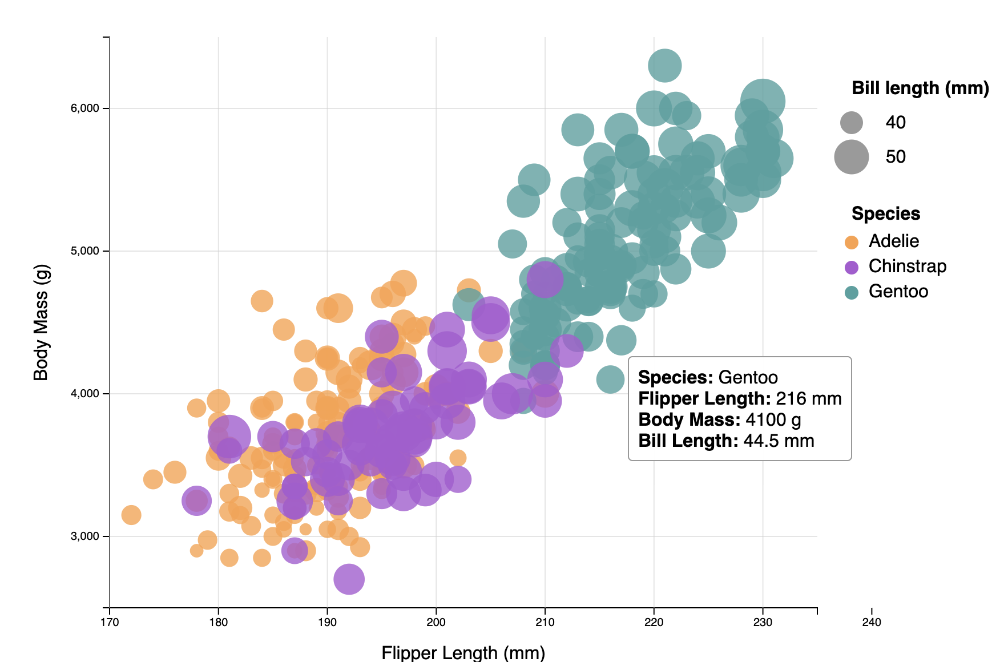
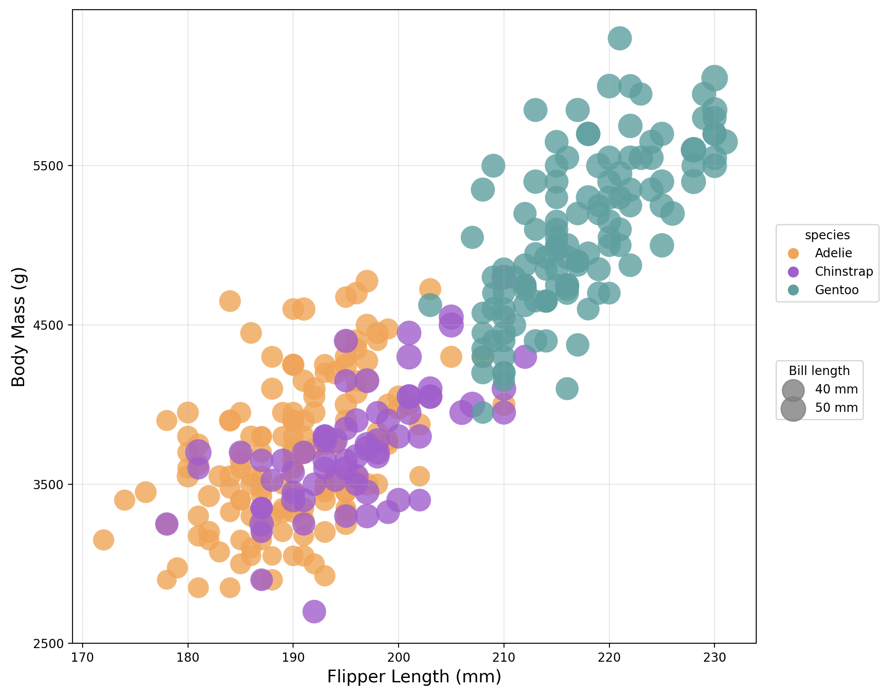
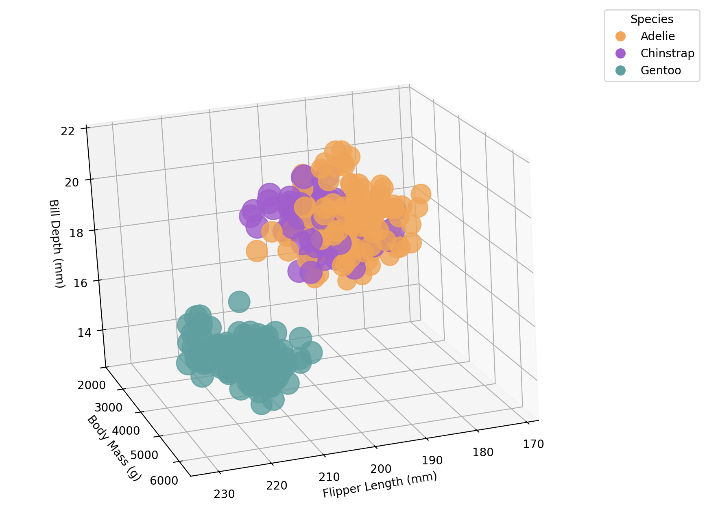
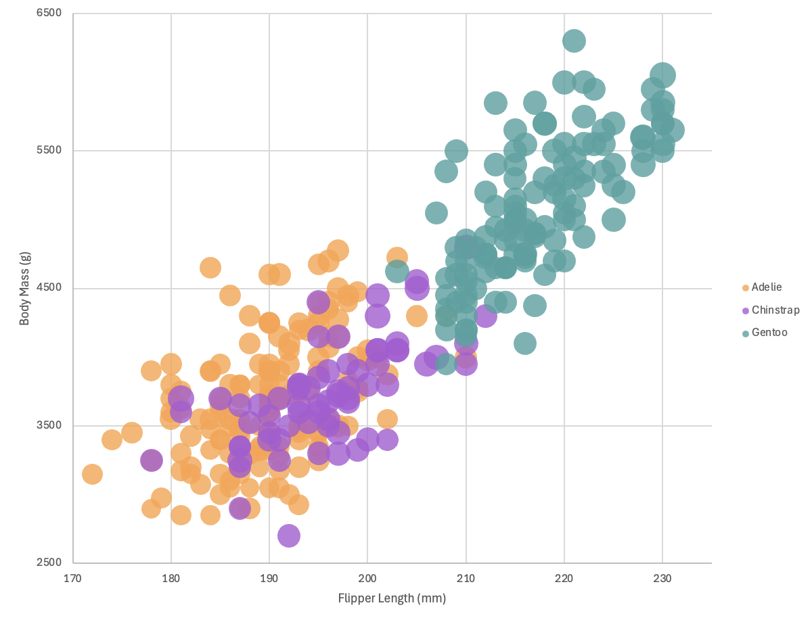
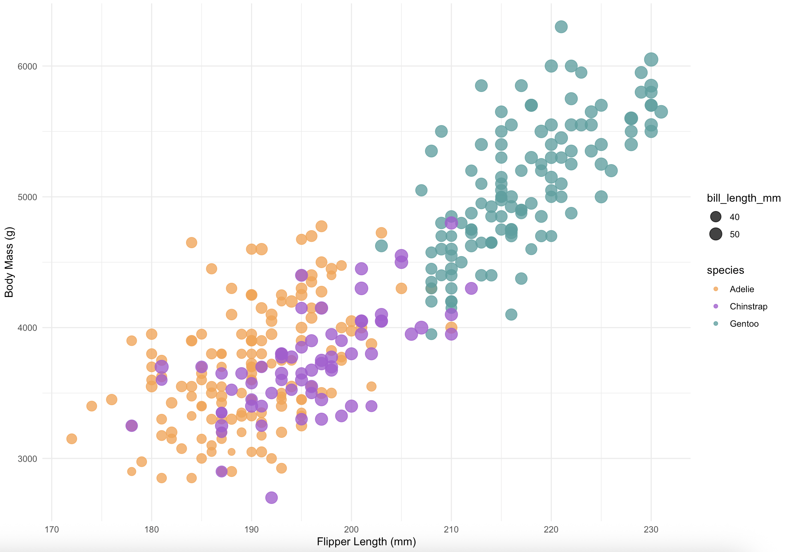
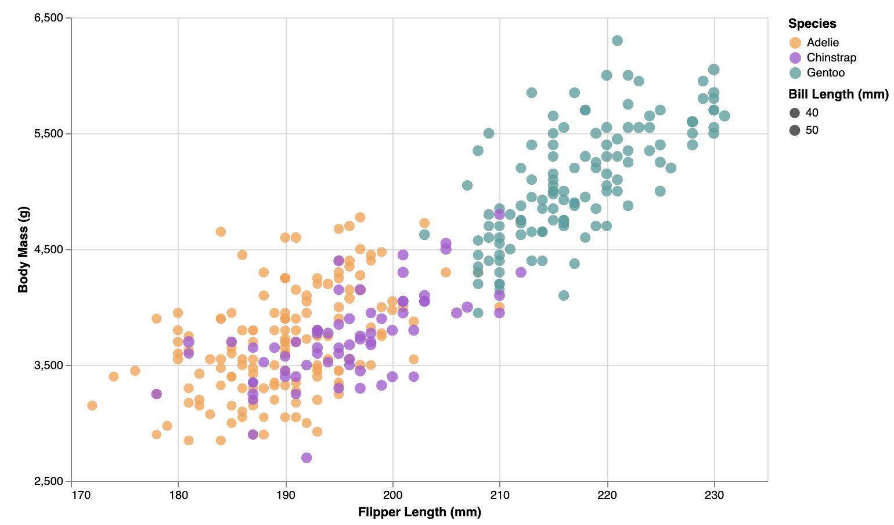

# 02-DataVis-5ways - Paola Frunzio

Assignment 2 - Data Visualization, 5 Ways  
===

## Description
Used `penglings.csv` dataset and created the same visualization using the following 5 tools
1. d3
2. python+matplotlib
3. excel
4. R+ggplot2
5. python+altair
All code in this project is my own, I did not use starter code or demo programs from the web. I did use the w3schools tutorials for help with D3 and R. 

## d3
`
Replicated scatter plot using D3. Also available on GitHub pages here: https://pfrunzio.github.io/a2-DataVis-5ways/d3/d3.html

D3 was relatively simple to use becaue I had practice from A2, but it wasn't the simplest. It used over 4x more lines of code than the next longest implementation. However, it was the easiest to add interactive components to. D3 allowed me to replicate create the scatterplot and very easily add the interactive tool tips to make the data more accessible. The most challenging part of this implementation was understanding how to deal with the axes and scales to replicate the original visualization as closely as possible with tick mark intervals and the grid. I also had to position the legends manually, instead of for example just setting them to be on the left of the figure the way I was able to with matplotlib. Overall, D3 is a powerful tool for interactive visualization and for easy display in a webpage, but I wouldn't use it for non-interactive visualizations since it takes so many more lines of code than the other options. 

## python+matplotlib
`
Replicated scatter plot using the matplotlib and pandas libraries in python.

`
Upgraded scatter plot in 3D using the matplotlib and pandas libraries in python.

Matplotlib felt really easy to use for creating both the 2D scatterplot and the 3D version. This was the easiest one for me because I have a lot of experience using mpl for data anlysis in experimental physics, as its the most common library I've used in research projects. The functions are very clear for customizing axes, labels, gridlines, legends, etc. Adding a 3D scatter plot was simple since its built into the library, and allowed me to easily represent another variable with minimal additional effort. The most difficult part was managing legend placement for both color and size, since mpl doesn’t natively generate the bubble size legend and combine them. I created custom Line2D objects for the bill sizes and used the add_artist() method to get both of the legends into the figure. Overall, mpl is very flexible and useful for clean looking plots where interactivity isn't required. Pandas allowed for simple data cleaning. 

## excel
`
Replicated scatter plot using excel. 

Excel was by far the most frustrating of these tools to work with. I was curious to compare the other software to excel because of its prominence in corporate culture and office jobs, however, I found that it was much more manual than writing a script with one of the other tools. I wouldn't be able to change a few lines of code to substitute in a different csv and column names and get a new plot almost instantly. I would instead need to go into the app and manual redo all of the steps I took. It was also relatively challenging to find the right buttons in the interface, although now that I am more familiar with it, it would probably be easy to make more plots of similar types. Excel was also the least powerful and flexible tool among this set of five as I wasn't able to add a legend for the bubble size or automate cleaning the data. 

## R+ggplot2
`
Replicated scatter plot using the ggplot2 package in R.

I was surprised how few lines of code were needed to implement this plot in R with ggplot. The ggplot function was very simple and straightforward to use. Customizing the axes, labels, gridlines, legends, etc. was very easy because of this built in functionality. ggplot also automatically drops Null data which meant that I didn't have to do additional data cleaning. R and ggplot seem useful for exploring the data and creating static plots since it's the software that requires the fewest lines of code and would be very easy to quickly adapt for different graphs and data sets. 

## python+altair
`
Replicated scatter plot using the altair library in python. Also available on GitHub pages here: https://pfrunzio.github.io/a2-DataVis-5ways/altair/altair.html

Altair was very convient, and although I had never heard of it before, was easy to learn since it's just another python library. The syntax felt like a cross between matplotlib and ggplot, and was the second shortest program for these five visualizations. It was easy to customize the axes, labels, gridlines, legends, etc. A challenge I ran into was originally naming the scritp altair.py, which gave a circular import error until I renamed it to include "implementation". Altair was the second easiest to try interactive visuals with, after d3. Like with d3 and matplotlib, I had to do some data cleaning to remove datapoints with missing values before plotting. I used the same pandas function that I used for matplotlib, which was convient since all three of matplotlib, pandas, and altair are python libraries and therefore can be easily used together. As someone who uses python a lot for physics research, this is definetly a tool I can see myself continuing to use as it would be easy to integrate into existing python scripts and can more easily make interactive visualizations than matplotlib can. 

# Technical Achievements
- Implemented the original scatterplot in 5 different languages (D3, python+matplotlib, excel, R+ggplot2, python+altair).
- Added interactive tool tips in D3 to show the values for each data point when hovering over it.
- Created interactive 3D plot in matplotlib to show an additional axis of data.
- Loaded the data from the csv and performed data cleaning in each of the languages to remove data points with Null values.
- Hosted my D3 and altair implementations on GitHub pages for easy viewing.
- Customized all of the implementations in their softwares to match the visuals in the example.

# Design Achievements
- Maintained visual consistency and preserved as many features as possible, including the option background grid and legends, from the example plot across languages:
  - Data positioning: maintained in all 5 implementations
  - Scales: maintained in all 5 implementations
  - Axis ticks and labels: maintained in all 5 implementations
    - d3: customized the tick size to make the grid and axes look like the example
  - Color mapping: maintained in all 5 implementations
  - Size mapping: maintained in all 5 implementations. In excel, I had to manually size to make them more visually similar to the example.
  - Opacity of circles set to 0.8: maintained in all 5 implementations
  - Background grid: maintained in all 5 implementations
  - Legend: maintained in all 5 implementations
    - matplotlib required creating a custom bubble size legend with Line2D and using the .add_artist() to combine both legends.
    - excel: size mapping wasn't included in the legend because excel doesn't have that native capability
    - R+ggplot2: was also able to keep the vertical order of the size and species legends by using the guides() function
    - altair: used .configure_legend() to ensure correct vertical order of the size and species legends
- Used a colorpicker to get exact hex codes from example and matched up all of the colors exactly across plots with the example
