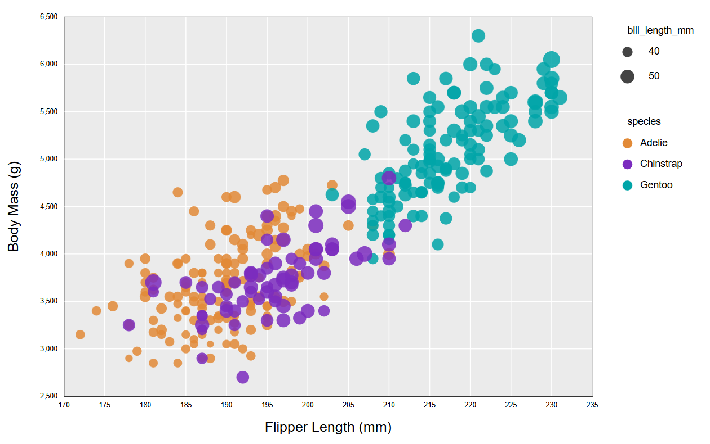
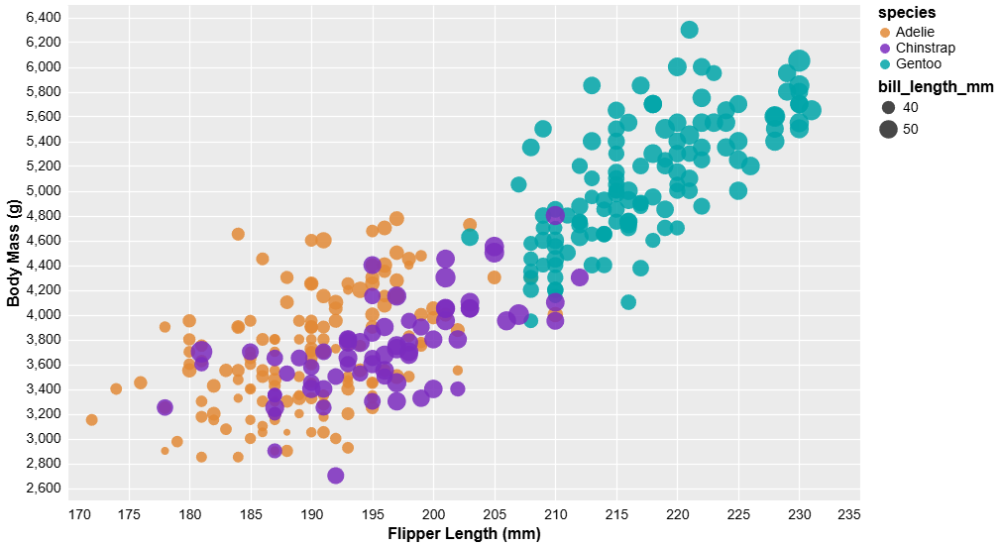
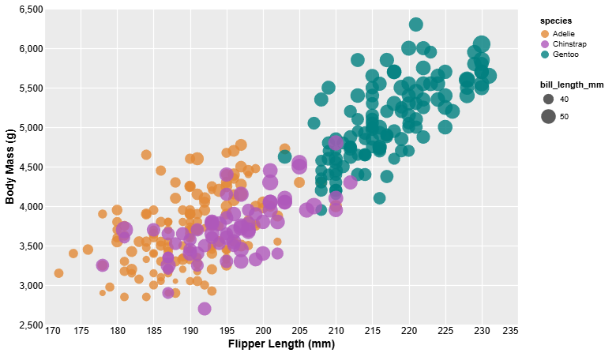
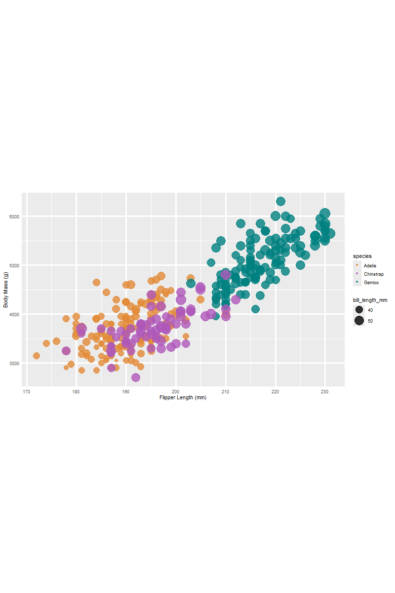
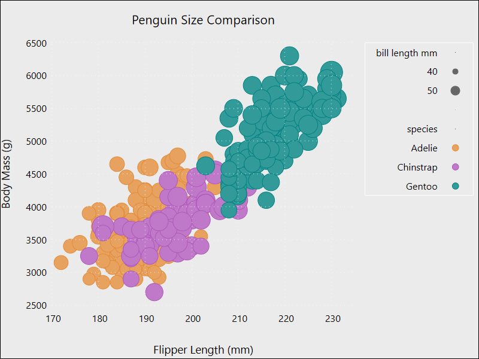

## Assignment 2 - Data Visualization, 5 Ways
**Peter Czepiel**

## Here is the visualization I was asked to recreate:

## Here are the 5 Ways that I chose to do this:

# D3:

Out of the 5 frameworks and libraries I chose for this project, D3 was the easiest when it came to recreating the original visualization. This is definitely partly due to the fact that I have the most experience using it, but it was also just very straightforward. I also believe that my D3 recreation is the most similar to the original out of all the tools I chose to use. I could see this tool being extremely useful for making data visualizations in the future. In fact, I have recently used D3 in my MQP to create a visualization of finance data, and it was extremely helpful and easy to use. To get the chart looking mostly correct, I did have to leave out some aspects of the original. For example, (and I had this problem with most of my recreations) I was unable to get the scaling of the "bill_length_mm" bubbles and the axises to be the same. This causes my recreation to look a bit more zoomed/spaced out then the original. Other than that, D3 was very simple and easy to use. 

# Altair

Altair was another tool that was relatively intuitive when it came to recreating the original visualization. Even though I had never used it before, and I have no formal Python experience, I found it to be extremely straightforward. One of the only things I had to consult documentation for was the use of "alt.scale", as when I first made my chart, the scaling and sizing was complete off. I also had some issues with the legend part of the visualization. On my first attempt, all sizes of bill length were listed (10mm-50mm) even though only 40mm and 50mm were used. I also had an issue with the order of the items on the legend (species being on top of the bill length), which I was unable to fix even after consulting lots of documents. I could see Altair being useful in the future for creating visualizations with very complex data, as the seperation between points is very clear compared to some of the other recreations. The only hacks I had to use to make this recreation was the scaling that I previously discussed.

# Vega-Lite

Vega-Lite was a good tool when it came to recreating the original visualization. With this tool, I will say there was a bit of a learning curve for me as someone who had never used it before, but I found that once I understood the overall structure and basic syntax, it became pretty easy. Most of the issues I had with the tool came from the fact that I am not very skilled in using json files or having to write them from scratch with its specific syntax. That being said, I think that Vega-Lite produced the second most similar recreation. I could see this tool being useful in the future when creating a visualization that has a lot of content within the legend. In my opinion, Vega-Lite had the most straightforward process when it came to adding a legend, thanks to the way that the json is laid out. I did not have to use any hacks or data manipulations for this chart.

# R + ggplot2
Using R and ggplot2 was an interesting process for me. My recreation of the chart using R is my shortest in lines of code compared to the other tools, but I had to spend a decent amount of time on it due to a few issues. I found the actual code and syntax to be very straightforward (probably because R is basically plain English), but the errors I was encountering were annoying to fix. The main one I had issues with was the fact that my file could not find the "penglings.csv" file, even though it was in the same folder. This could be because I was using the R extensions in Visual Studio Code, but I had to eventually change the read command to have the entire path to the file. Along with this, the png file that was given to me when I ran my code is in landscape, causing the chart to be a bit squished and there to be a lot of whitespace. I tried to fix this for a long time, but I could not figure it out even after consulting documentation. I could see R and ggplot2 being useful in the future for visualizations that are more calculation heavy (since R is good for math). Other than the path issue, the only manipulation I had to do was fixing the ordering of the legend, which was pretty easy.

# GNUPlot
GNUPlot was the worst tool out of the 5 that I chose. Just like Vega-Lite, I found GNUPlot to have a steep learning curve for someone that had never used it before, but even after creating the visualization I did not feel that I had gotten much better. Out of the 5 tools I chose, my recreation using GNUPlot is the least similar to the original. A lot of the problems I have with this tool is that way that the code is laid out. The syntax and file structure is so different from the other tools that I used, making it seem much more primative. I also had to consult a lot of documentation when it came to figuring out the plot part of my recreation, which took a long time. I could not see myself using this tool in the future and I think all the other tools above are much more effective. To make the chart I made, I had to manipulate the data a lot on the chart. Specifically, I had issues with the sizing of the dots being the same, and even now it is hard to tell which dots are smaller than the others.

## Technical Achievements
- **Interaction**: In the tools that supported it (D3, Vega-Lite, Altair) I made sure that upon running my code you would be greated with a chart that you could interact with. This interaction was simple, the user was able to hover over the specific circles and see the exact data points.
- **Simplicity in Running**: In an effort to keep all my code simple, I made sure to keep all needed code within one executable file for each of the tools. This makes it easy for someone else to run my code without explicit instructions.

## Design Achievements
- **Consistent Color Choice**: I used the same Hex values for the three colors in all the graphs (even though some graphs seemed to intrepret it differently, as the colors look a bit off). These hex codes were: "#E28A37" for Adelie, "#AF58BA" for Chinstrap, and "#008080" for Gentoo. I chose these as I thought they were closest to the colors used in the original.
- **Consistent Font Choice**: Along with using the same colors for each chart, I also used the same font (Segoe UI) for all the charts to be consistent.
- **Consistent Background**: In all of the charts (except for GNUPlot because I couldn't figure it out) I used the same style as the original chart, with everything being white except for the graph background being grey.
