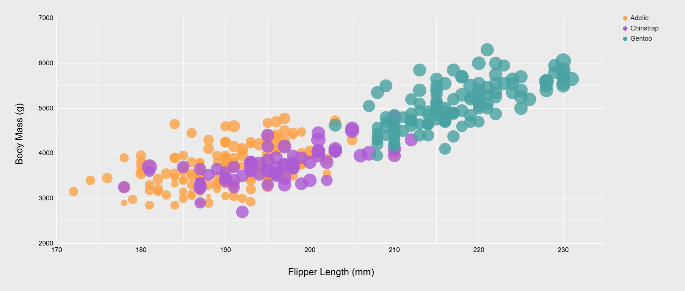

# 02-DataVis-5ways
### Assignment 2 - Data Visualization, 5 Ways

Libraries, Tools, Languages
---

Languages = `Python, R, Javascript`

Tools = `ggplot2, Google Sheets, D3, Altair, Vega-lite`

---

### Altair
...

### D3
...

### ggplot2
R is a language primarily focused on statistical computing, and ggplot2 is a popular library for charting in R.

### Google Sheets

Google Sheets is a free, cloud-based spreadsheet application that is a part of the Google Workspace suite.
It uses a JavaScript based API to access and modify spreadsheet data and charts.

In order to run the script, you must create a Google Sheet with the penglings data imported into a sheet titled "penglings".
From there, you must copy-and-paste the JavaScript code into a Google App Script (which can most easily be accessed in the `Extensions` window).
Finally, you must change the spreadsheet ID found on Line 2 to that of your created spreadsheet (ex: `https://docs.google.com/spreadsheets/d/SPREADSHEET_ID/edit?gid=...`).
Afterwards, you can simply click the `Run` button and it will generate the chart for you in a "Chart Only Window" ("COW").

Overall, the Google Sheets API (and Google Workspace APIs in general) are sorely lacking.
Google has managed to create a system in which fine-tuning requires using the API, but making standard changes (such as copying / duplicating a chart, setting minimum step distances between labels, and copying charts from "COW"s) is impossible.
I initially only used the API to control the maximum and minimum sizes of the bubbles in the bubble chart, but soon discovered that if I wished to display my chart in a "COW", I would need to regenerate the chart every single time I wished to make a modification.
This is because Google treats the chart as an object upon being converted to a "COW" and afterwards supplies zero functionality to modify the chart any further, including moving or copying it to a new spreadsheet.
Google Sheets has a lot of weaknesses and very limited customizability, but as long as you stick only to the UI, creating a mock-up of a simple proposed chart is quite easy.

### Vega-lite
...

Other Requirements
---

All files can be found in the `./tools` folder

### Technical Achievements
- Some ideas include interaction, such as mousing over to see more detail about the point selected.
	
- Used Google Sheets' Scripting API to fully create a chart that can regenerate and cleanup after itself from a single button press.
The Google suite API is notoriously hard to work with as it is unintuitive, has constantly out-of-date documentation, and few examples especially when dealing with chart manipulation.

### Design Achievements
  - Some ideas include consistent color choice, font choice, element size (e.g. the size of the circles).
