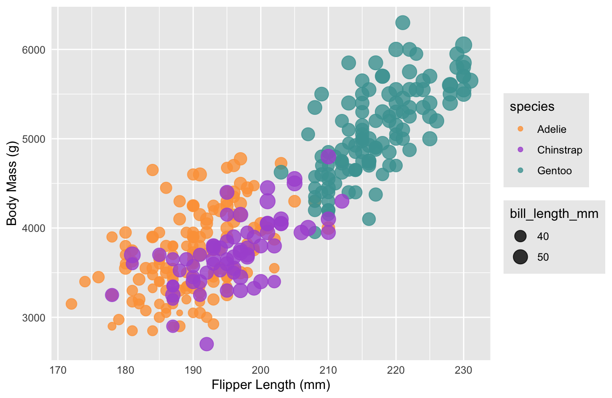

# 02-DataVis-5ways
### Assignment 2 - Data Visualization, 5 Ways

Libraries, Tools, Languages
---

Languages = `Python, R, Javascript`

Tools = `ggplot2, Google Sheets, D3, Altair, Vega-lite`

---

### Altair
...

### D3

D3 is an open-source JavaScript library used for visualizing data.
Setting up D3 was a little hard as documentation varies for the different versions, but manipulating the various SVG elements proved quite intuitive.
D3 is a great resource for making much more complex and freeform graphs as you are drawing a majority of the structure yourself.
While this can be a lot more freeing, it can also prove to be a bit of a hassle when you just want to make a basic visualization.

### ggplot2

R is a language primarily focused on statistical computing, and ggplot2 is a popular library for charting in R.
ggplot2 was very easy to manipulate, reading in data was extremely simple, and changing the output to fit the needs of the project was trivial.
R seems like a great resource to filter and display large quantities of data in beautiful graphs with minimum effort.

### Google Sheets

Google Sheets is a free, cloud-based spreadsheet application that is a part of the Google Workspace suite.
It uses a JavaScript based API to access and modify spreadsheet data and charts.

Overall, the Google Sheets API (and Google Workspace APIs in general) are sorely lacking.
Google has managed to create a system in which fine-tuning requires using the API, but making standard changes (such as copying / duplicating a chart, setting minimum step distances between labels, and copying charts from "Chart Only Window"s) is impossible.
I initially only used the API to control the maximum and minimum sizes of the bubbles in the bubble chart, but soon discovered that if I wished to display my chart in a "Chart Only Window", I would need to regenerate the chart every single time I wished to make a modification.
This is because Google treats the chart as an object upon being converted to a "Chart Only Window" and afterwards supplies zero functionality to modify the chart any further, including moving or copying it to a new spreadsheet.
Google Sheets has a lot of weaknesses and very limited customizability, but as long as you stick only to the UI, creating a mock-up of a simple proposed chart is quite easy.

### Vega-lite
...

Other Requirements
---

All files can be found in the `./tools` folder

### Technical Achievements
- Used Google Sheets' Scripting API to fully create a chart that can regenerate and cleanup after itself from a single button press.
The Google suite API is notoriously hard to work with as it is unintuitive, has constantly out-of-date documentation, and few examples — especially when dealing with chart manipulation.

### Design Achievements
- Consistent color and design themes
	- Use of the same color pallette for Species markers and plot background
	- Use of Ariel font and similar font sizes
	- Use of the same / similar circle sizes
	- Use of both legends (where possible)
