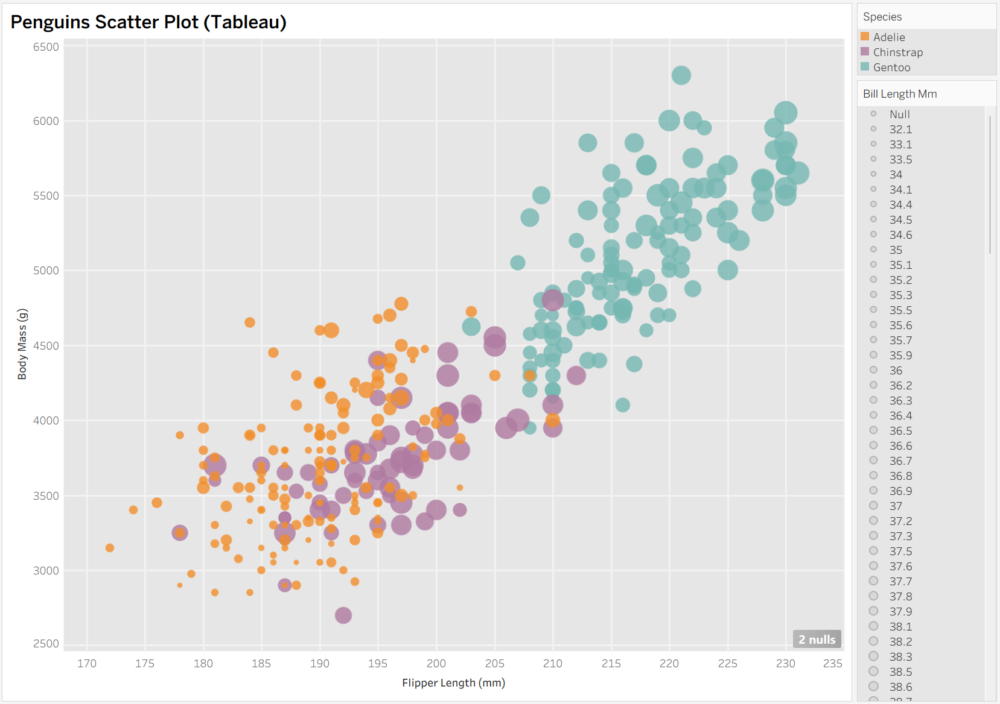
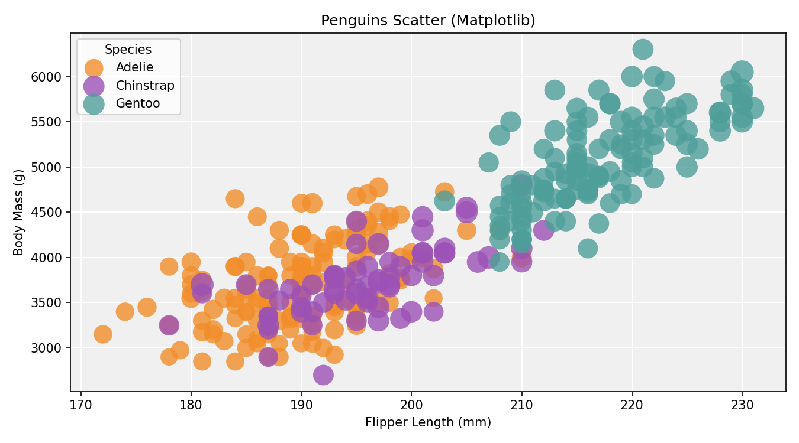
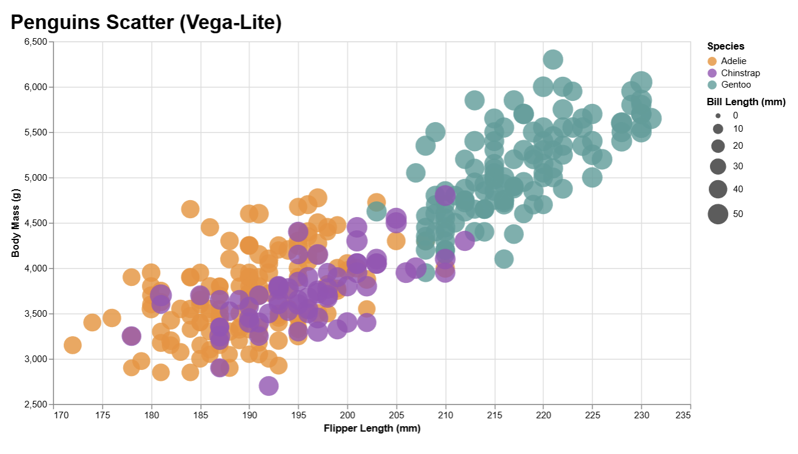

# Assignment 2 – Data Visualization, 5 Ways
# Aishwarya Sinha

This project recreates the same penguins scatterplot using five different visualization tools and libraries.  
Each chart uses:

- **X-axis:** Flipper Length (mm)  
- **Y-axis:** Body Mass (g)  
- **Color:** Species  
- **Size:** Bill Length (mm)  
- **Opacity:** Semi-transparent points (opacity 0.8)  

The dataset used for all visualizations is `penglings.csv`.

# d3.js

For the d3 visualization, I implemented the scatterplot using SVG elements and d3’s scale and axis utilities. Data was loaded asynchronously using `d3.csv` with `d3.autoType`, and rows with missing values were filtered out before plotting.

This tool required the most manual work, especially figuring out margins, coordinate transforms, and debugging data loading paths. However, it also offered the most flexibility. I added an interactive tooltip that appears on hover, which displays the species and exact values for flipper length, body mass, and bill length.

**Sources**
- https://d3js.org/
- https://github.com/d3/d3/blob/main/API.md
- https://observablehq.com/@d3/learn-d3

# Tableau

Tableau allowed me to recreate the scatterplot quickly using a drag-and-drop interface. After disabling automatic aggregation, each row in the dataset was plotted as an individual point. Species was mapped to color, bill length to size, and opacity was adjusted to reduce overplotting.

One challenge was ensuring that Tableau did not aggregate size or position by default, which required me explicitly adjusting measure settings. Tableau is very effective for rapid exploratory analysis and presentation-ready charts, but it offers less low-level control than code-based tools.

**Sources**
- https://help.tableau.com/current/pro/desktop/en-us/buildexamples_scatter.htm

---

# Altair (Python)

Altair was straightforward to specify details for position, color, and size. The scatterplot was generated from a cleaned pandas DataFrame and exported as an interactive HTML file.

I customized the color palette to match the other visualizations and adjusted the size scale to ensure smooth variation by bill length. Compared to d3, Altair requires much less code and is easier to read, but offers less freedom for custom interactions.

**Sources**
- https://altair-viz.github.io/
- https://altair-viz.github.io/user_guide/marks/circle.html
- https://altair-viz.github.io/user_guide/encoding.html

---

# Matplotlib (Python)

The matplotlib visualization was created using Python and required manually grouping the data by species and plotting each group separately. Size scaling and color assignment were handled explicitly in code.

To improve the aesthetics, I managed to customize the plot with a light gray background and white gridlines, similar to the reference image. Matplotlib provides more detailed control over styling, but also subsequently requires more detailed code compared to Altair.

**Sources**
- https://matplotlib.org/
- https://matplotlib.org/stable/api/_as_gen/matplotlib.pyplot.scatter.html

---

# Vega-Lite

Vega-Lite allowed me to make the entire visualization using a JSON specification. Encodings for position, color, size, and opacity were specified, and a custom color scale was used to match the other charts.

I struggled with font sizes for the title, axes, and legends, meant to improve readability and adjusted the chart width to better match the reference. Vega-Lite is powerful for producing consistent visualizations with minimal code, though debugging JSON can be more challenging than working in a programming language.

**Sources**
- https://vega.github.io/vega-lite/
- https://vega.github.io/vega-lite/docs/
- https://vega.github.io/vega-lite/examples/

---

## Technical Achievements

- Implemented interactive tooltips in the d3 visualization to display detailed information on hover
- Successfully reproduced the same visual encodings across five different tools and libraries
- Handled data cleaning and missing values consistently across all visualizations
- Customized size scaling in Altair, Matplotlib, and Vega-Lite 

---

## Design Achievements

- Maintained a consistent color palette for species across all visualizations
- Specified point opacity and size per bill-length
- Improved readability through larger fonts and clear axis labeling
- Added subtle gridlines and background styling in Tableau, Vega-Lite, and Matplotlib to enhance visual clarity

---

## Repository Structure

d3/ # d3.js visualization
tableau/ # Tableau workbook
altair/ # Altair Python script and HTML output
matplotlib/ # Matplotlib Python script
vega-lite/ # Vega-Lite JSON spec and HTML
data/ # penglings.csv
img/ # screenshots of all visualizations
README.md

