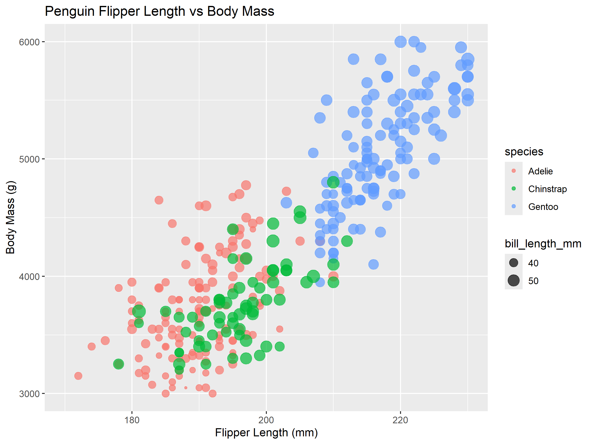
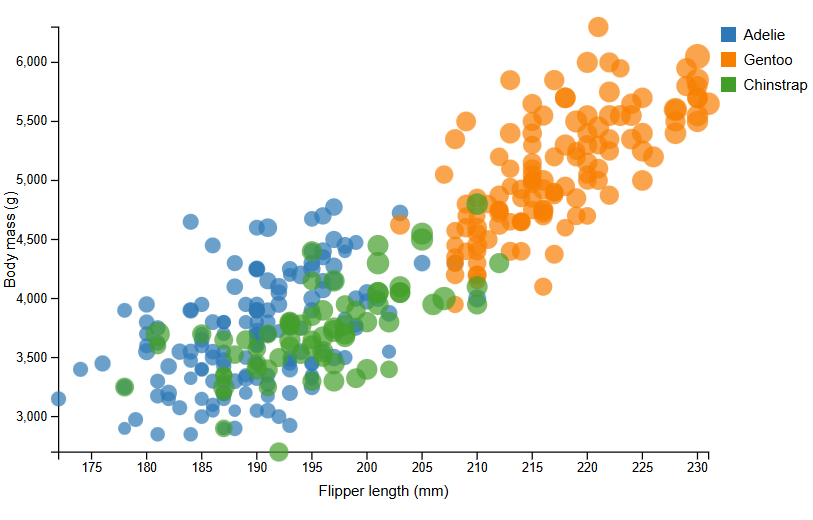
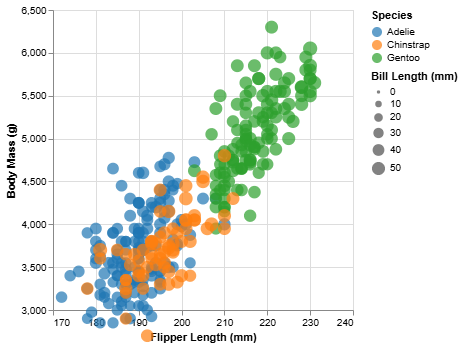
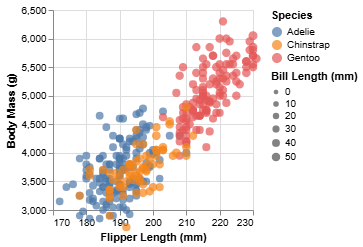
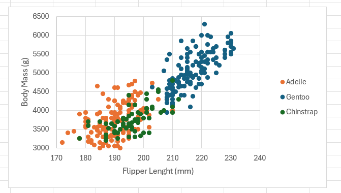

Asha Buchanan
Assignment 2

# R + ggplot2 + R Markdown

R is a language primarily focused on statistical computing.
ggplot2 is a popular library for charting in R.

To create the chart I made use of ggplot2's `geom_point()`to make a sccatter plot. 

It did take some time to understand the documentation, but this implementation was one of the easier processes. 

# d3
I utilized the d3 library using html and svg. We began getting familiar with d3 in assignment 1, so it was nice to build significantlty on that. 

The set up of the chart did get a bit tedious at times, but using the documentation and just researching how to do it correctly was not too difficult but did require a bit of time. 

I could not figure out how to add the key for the size of the points (bill length) but I still think this implementation was good. 

# altair

Altair is a visualization library python. I was unfamiliar with this before this assignment, so it also did take a bit of time and research of the documentation to figure out how to implement it. 

Once figuring out the syntax, it was one of the easier implementations and I was able to save the chart as an html file (which also took some time to figure out how to get it to display)

# vega-lite

Vega-lite is another library for visualizations that prior to this assignment, I was not familiar with. 

But, I was able to complete the implementation fairly smoothly after reading up on it, and this was also another fairly simple implementation after reaserching the syntax. 

# excel

This is the standard data entry tool, but for this assignment was the most tedious. This was simply because I was very rusty on my excel skills so it took a bit of time to figure out how to get each species its own category.

Once I figured out how to create a seperate series for each specie, it was smooth sailing from there. I also was unable to figure out how to put the key and the scale for the bill length for this one, so it wasnt that successful of an implementation but I think it still communicates most of the information.

## Technical Achievements
- Created the same scater plot using 5 different tools, acheiving the goal of the assignment. 

### Design Achievements
- Tried to ensure that all axis ranges and all scales were set in a way to ensure the easisest readability. 