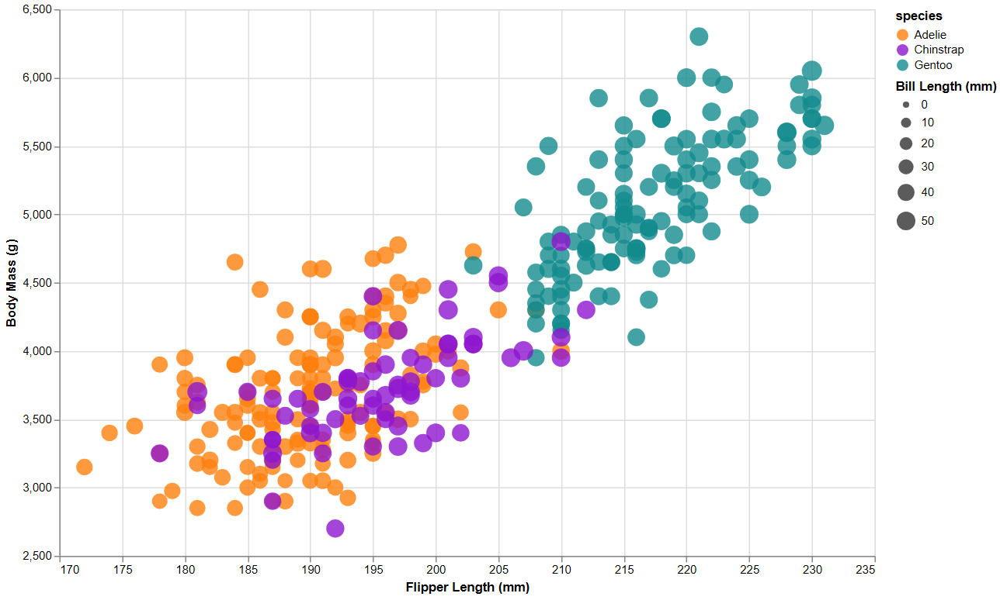
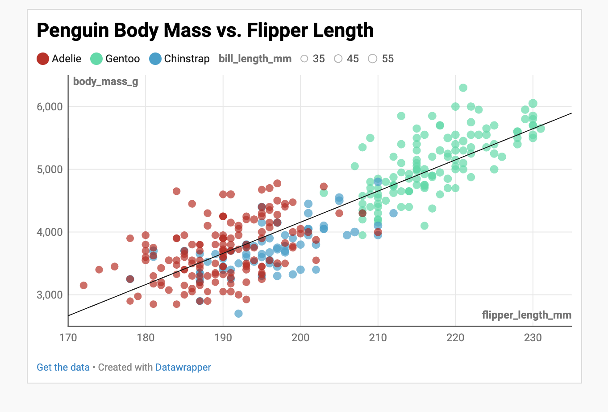
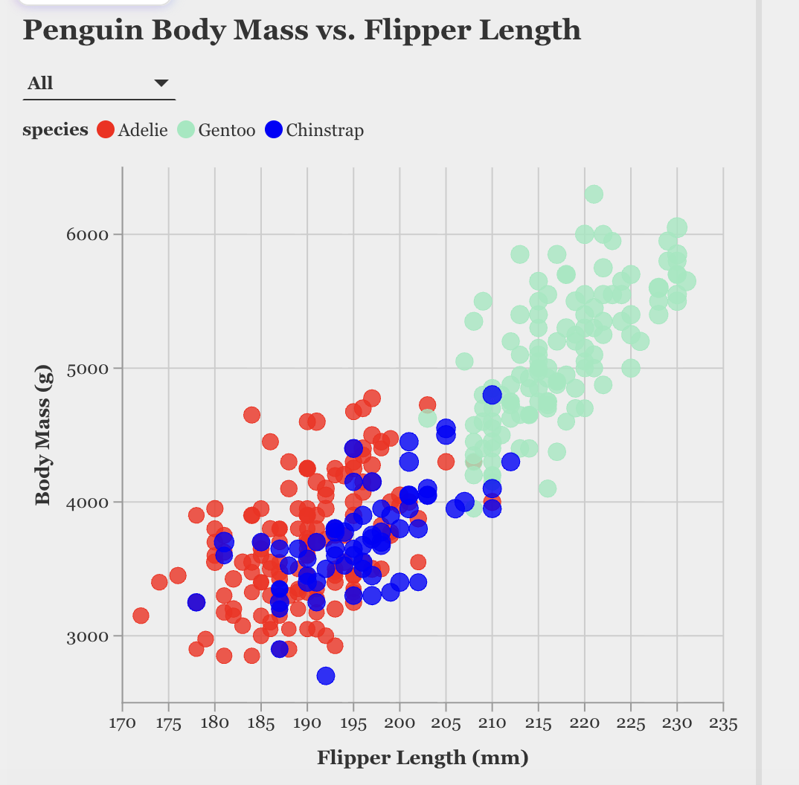

# Assignment 2 – Data Visualization, 5 Ways

**Charles Davis | CS4804**

# 1. D3.js

D3.js uses JavaScript to create and modify scalable vector graphics (SVG), which include shapes, animations, and structures. Something I learned was how to load CSV files, use numerical scales, and set up tooltips, legends, and filters.

# 2. Altair

Altair uses a Python visualization library. Some of the features used were data encoding, numerical scales, interactive legends, hover tooltips, and HTML output. Altair requires less code than D3.js because it uses Python library commands, but it offers less control over chart design and customization compared with D3.js.

# 3. Vega-Lite

Vega-Lite functions as a declarative visualization library using JSON. Its features include scatterplot data mappings, custom scales, tooltips, and interactive filtering. This requires relatively little coding, but its main distinguishing feature is that it uses a JSON structure. It offers high customizability, but not as much as D3.js. I used `index.html` to load and display the chart.

# 4. Datawrapper

[Interactive Chart](https://datawrapper.dwcdn.net/WYAWR/3/)

The easy part of Datawrapper was that I could upload the CSV to a website and visualize the data without writing code. The main challenge was learning and understanding the UI. I liked how I could manually choose everything and see the changes in real time instead of coding, running it, and then having to go back and make changes.

# 5. Flourish

[Interactive Chart](https://public.flourish.studio/visualisation/30912723/)

Flourish is also a visual tool that uses a graphical interface to make the chart. Flourish took the most time but also offers greater accessibility to non-programmers.

# Technical Achievements

I added hover functionality to display penguin species, body mass, flipper length, and bill length when the cursor is over a circle. I also implemented a clickable legend and filter that lets users see each penguin species. On top of this, each transition has a short fade animation in D3 when filtering species. Finally, I learned to use multiple technologies to create this visualization, such as JavaScript, Python, JSON, and two in-browser tools.

# Design Achievements

For the design, I changed the colors to red, blue, and seafoam green to show the different species. I attempted to keep as much of the same formatting across all platforms as possible. I included legends for species and bill length.

# How to Run

### 1. D3.js

1. Download or clone the GitHub repository.
2. Open Terminal in the main repository folder.
3. Run `python3 -m http.server 8000`.
4. Open `http://localhost:8000/d3/` in a browser.

### 2. Python + Altair

1. Open Terminal in the main repository folder.
2. Install dependencies using `python3 -m pip install -r altair/requirements.txt`.
3. Run `python3 altair/chart.py`.
4. Open the generated `altair/altair_penguins.html` file in a browser.

### 3. Vega-Lite

1. Open Terminal in the main repository folder.
2. Run `python3 -m http.server 8000`.
3. Open `http://localhost:8000/vega-lite/` in a browser.
4. The visualization loads using `index.html` and `chart.json`.

### 4. Datawrapper

View the published visualization:

https://datawrapper.dwcdn.net/WYAWR/3/

### 5. Flourish

View the published visualization:

https://public.flourish.studio/visualisation/30912723/

# AI Usage

ChatGPT was used to assist with programming for this assignment, generating code for D3.js, Altair, and Vega-Lite.

- **D3.js:** ChatGPT helped generate the initial scatterplot code, load CSV data, create axes and scales, implement hover tooltips, and add interactive species filtering.
- **Altair:** ChatGPT helped generate the Python code, configure data mappings and interactions, and set up the Python environment.
- **Vega-Lite:** ChatGPT helped generate the JSON visualization specification and HTML file.
