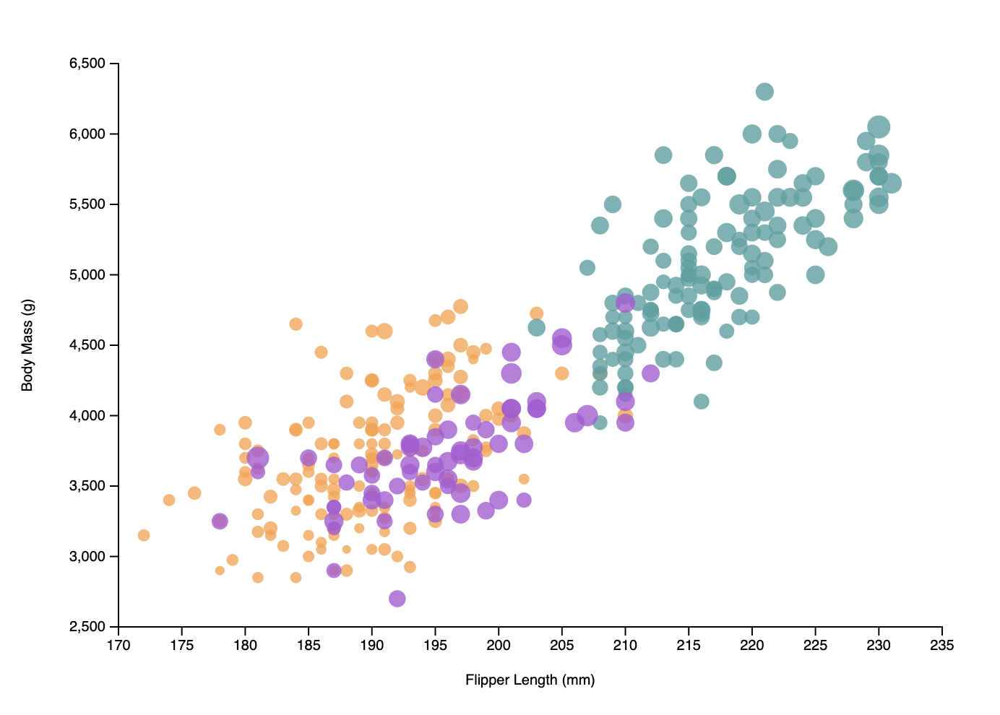
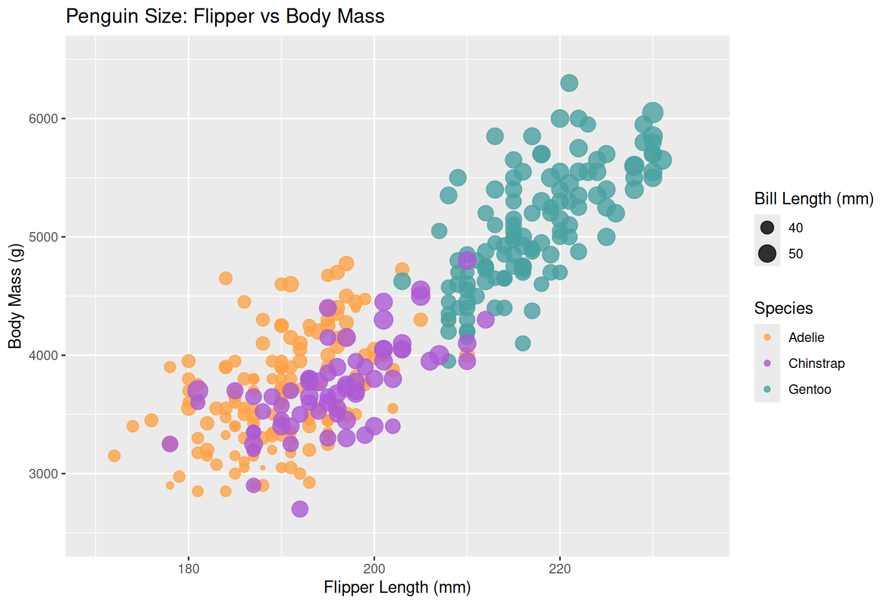
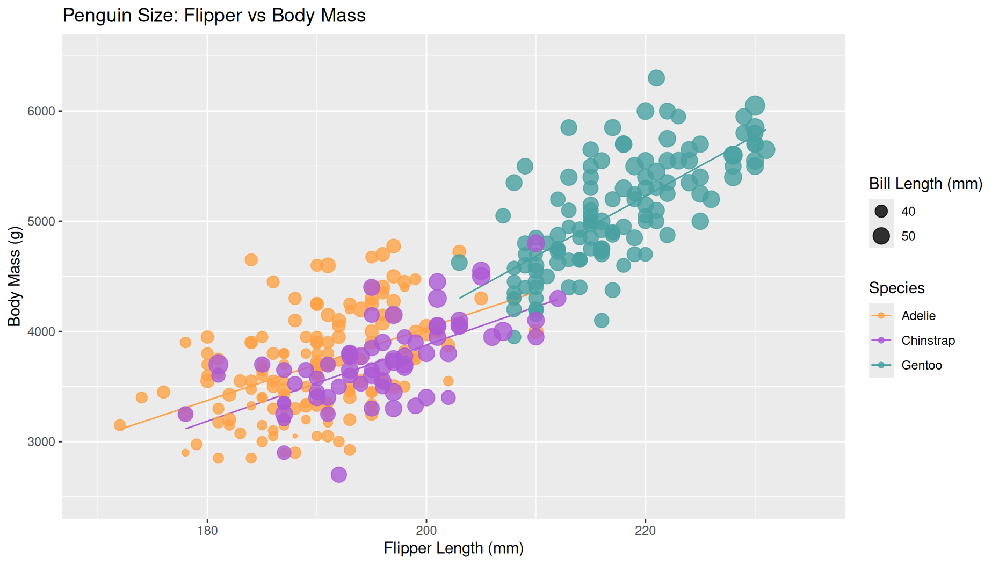
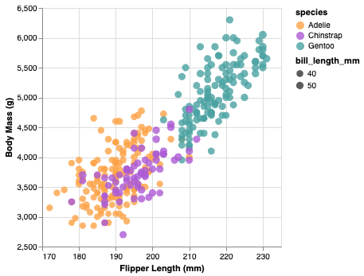
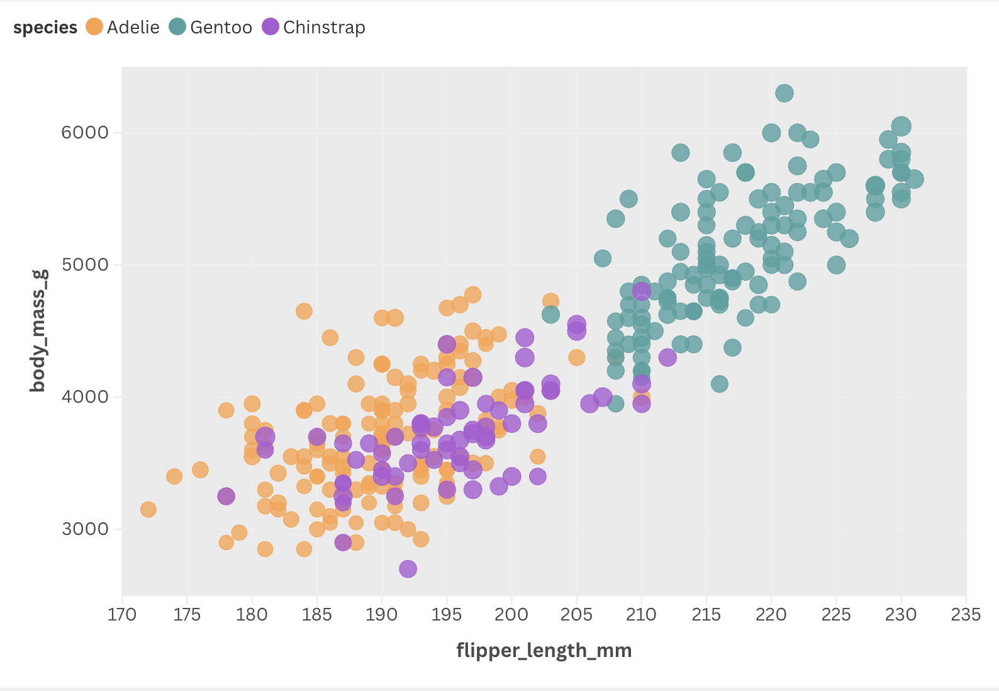
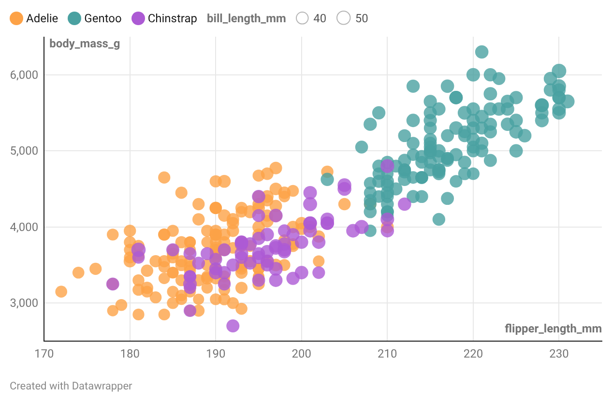

# Assignment 2 - Data Visualization, 5 Ways

This project replicates a specific scatter plot—analyzing the relationship between penguin flipper length and body mass—across five different visualization technologies. The goal was to maintain high design fidelity and consistent data mapping while exploring the unique strengths and interactivity of each platform.

---

## Technical Achievements
* **Advanced Interactivity (d3.js & Datawrapper)**: I implemented custom HTML-based tooltips that provide "details-on-demand" (Species, Mass, Flipper, and Bill Length), going beyond the static requirements.
* **Selection Binding (Altair)**: I added an interactive legend using `selection_point`. Users can click a species label to highlight its data cluster while others dim to 0.1 opacity, aiding in cluster isolation. Also, added feature for zooming and panning.
* **Staggered SVG Transitions (d3.js)**: By initializing the circle radii at 0 and using an index-based delay function .delay((d, i) => i * 2), I created a dynamic datapoints "popping" effect as the page loads.
* **Linear regression (R + ggplot2)**: I added a linear regression model (geom_smooth) over the data to visualize the growth correlation specific to each species.

## Design Achievements
* **Universal Color Branding**: I manually enforced a unified categorical hex-code palette (`#FDA247`, `#AC5AD4`, `#4AA1A1`) across all five tools, including those without native categorical mapping, to ensure a consistent project identity. These color are similar to the original scatterplot given, but I also check for color blindess accessibility with the feature on Datawrapper.
* **Optimized Data-Ink Ratio**: Per the rubric, all axes were configured to start at non-zero baselines (170mm for flippers, 2500g for mass) to maximize the "data-ink" area and highlight the correlation trends.
* **Legend Refinement**: I manually customized the size legends in R, Python, and d3 to display only the 40mm and 50mm breaks, reducing visual noise and matching the target original.
* **Visual Consistency (Opacity)**: I maintained a strict 0.8 opacity (or 20% transparency) across all platforms to handle overplotting in dense clusters effectively.

---

## 1. d3.js (Library)

* **Interactivity**: Multi-line HTML tooltips and hover-based stroke highlights. Entrance animation using transition.
* **Reflection**: d3 offered total control over every pixel but was the hardest one to do, took a lot of time to look at documentation. In the end, manually calculating scales and building axes from SVG elements provided the deepest understanding of the "under-the-hood" mechanics of web visualization. Also, since d3 requires manual work, you can control everything to your liking. I think this makes d3 the best library for creating unique data art, complex scrollytelling, or interactive tools that don't look like standard charts.
* **Resource**: This is what I originally looked at to learn how to make scatter plot in d3: https://d3-graph-gallery.com/graph/scatter_basic.html

## 2. R + ggplot2 (Library)

Replicate original

With regression line
* **Interactivity**: Static.
* **Reflection**: I had a hard time figuring out how to run R code on my machine. At first I don't want to download R studio, so I tried using Vscode with extension. I couldn't get it to work, so I move to using online tool Posit.cloud. The "Grammar of Graphics" is logical for mapping aesthetics. Using `scale_color_manual` and `scale_size_continuous` allowed for the most precise replication of the original design requirements. However, ggplot2 is static by default, and if you want to add interactive features, you will need to use a separate library to do so.
* **Resource**: https://www.sthda.com/english/wiki/ggplot2-scatter-plots-quick-start-guide-r-software-and-data-visualization

## 3. Python + Altair (Library)

* **Interactivity**: Interactive legend selection (click on a specie to make other species dim) and tooltips to show detail. Zoom and pan feature.
* **Reflection**: This was the most efficient coding experience. The declarative syntax allowed me to implement complex interactivity (like legend filtering and tooltip) with only a few lines of code. I think this library is the easiest to use since it does not require a lot of code and it is python, which I'm familiar with. At the same time, it still provided some good customization.
* **Resource**: https://altair-viz.github.io/gallery/scatter_tooltips.html

## 4. Flourish (Tool)

* **Interactivity**: Responsive hover effects, auto-filtering, and mobile-ready layout.
* **Reflection**: Flourish is a powerful GUI-based tool. It handled the "size" and "color" mapping instantly through column selection. I used the "Custom Overrides" feature to ensure the hex codes matched the coding libraries perfectly. It is fast and easy to use. It also provide the option for you to embed the visualization on your website. Flourish has ready to use preview of tablet and mobile layout too.
* **Published link**: https://public.flourish.studio/visualisation/27535733/

## 5. Datawrapper (Tool)

* **Interactivity**: Custom-formatted HTML tooltips.
* **Reflection**: Datawrapper was excellent for fine-tuning axis labels and gridlines. I utilized its custom HTML tooltip feature to provide a clean, descriptive interface for the penguin data. This also provide an option for embeded on to your website. This tool has a quick colorbind check feature, allow you to quickly see if your color palete works with different type of color blindness.
* **Published link**: https://www.datawrapper.de/_/INjDN/
---

## Quick comparison table

| Tool | Ease of Use | Customization | Verdict |
| :--- | :--- | :--- | :--- |
| **Altair** | High | High | Best balance of concise code and high-level interactivity |
| **Flourish** | High | Medium | Best for quick, professional, and mobile-responsive deployment |
| **ggplot2** | Medium | High | Excellent for academic precision and static publication |
| **Datawrapper** | High | Medium | Good for quick web charts with clean typography |
| **d3.js** | Low | Total | Unlimited potential for creative visualization but steep learning curve, extremely high development cost |